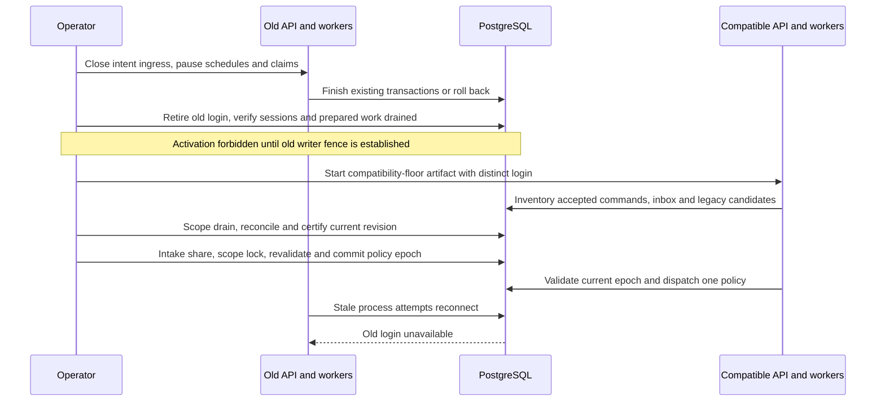
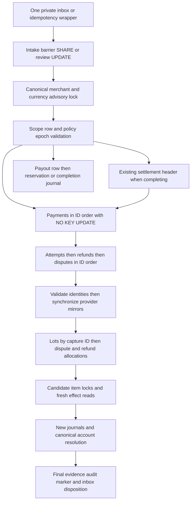

# H1 Fix 02 B3.2 Run A: runtime admission and cutover design

Status: **PROPOSED — AWAITING HUMAN APPROVAL.** Date: 2026-10-11. Owner: proposed F01 runtime cutover contract. Verdict: **DESIGN_READY_FOR_HUMAN_REVIEW**.

This document proposes future behavior. It does not authorize implementation, migrations, activation, deployment or financial repair. Current behavior remains owned by [Architecture](../architecture.md), [Database design](../database-design.md), [Concurrency](../concurrency.md), [Webhooks/idempotency](../webhooks-and-idempotency.md), [Refunds/disputes](../refunds-and-disputes.md), [Settlement/payout](../settlement-and-payout.md), [Outbox/RabbitMQ](../outbox-rabbitmq.md), [Reconciliation](../reconciliation.md) and [Verification](../verification.md). The [approved accounting policy](h1-fix-02-settlement-design.md#16-approved-b1-contract-2026-10-09) is unchanged. **F01 and F04 remain open.**

## 1. Executive summary

Recommend a maintenance/drain deployment that removes all incompatible writers, followed by an explicit, atomic activation of each verified merchant/currency scope. A single policy dispatcher and PostgreSQL admission contract must cover HTTP intents, provider evidence, financial application, settlement and payout. Registering dormant services or adding ACTIVE to a constraint is insufficient.

The admission authority is the existing canonical merchant/currency advisory key plus its locked accounting scope row. Add durable receipt/correlation evidence, a small intake review barrier for financial evidence with no trustworthy scope, fenced claim generations, and explicit policy/mode/epoch data. These are proposed additive changes, not installed fields. No independent service may select its own lock or fall back to legacy accounting after new-policy refusal.

Scope activation requires complete original and subsequent financial evidence, no unresolved blockers, drained accepted legacy obligations/candidates, tested writers and a verified old-binary fence. Start with clean, verified NEW_CAPTURE histories; uncertain or adjusted legacy histories remain legacy or paused pending a separately reviewed reconciliation. After a new-policy effect commits, recovery preserves that policy and uses pause/repair rather than an old binary.

Initial checkout: clean `main`, HEAD `052421a6c90b4aadbcde957ef4e5268c7632a124`, committed B3.1 verification; parent `a9321d837f3cebd4594e67f27558218817159a46` is accepted B2.4. Local main is one commit ahead of origin/main. The human authorized this design after B3.1 returned READY_FOR_B3_2_DESIGN. There is no uncommitted implementation or acceptance blocker to resolve first.

Read repository instructions/workflow, the [H1 audit](h1-financial-correctness.md), [Run A/B1 policy](h1-fix-02-settlement-design.md), [B1](h1-fix-02-b1-allocation-foundation.md), [B2.1](h1-fix-02-b2-1-capture-integration.md), [B2.2](h1-fix-02-b2-2-refund-integration.md), [B2.3](h1-fix-02-b2-3-dispute-integration.md), [B2.4](h1-fix-02-b2-4-settlement-integration.md), [B3.1](h1-fix-02-b3-1-integrated-verification.md), current owners and executable paths below. No application code, tests, SQL or existing financial policy changes in Run A.

## 2. Current executable runtime routing matrix

[AppModule](../../apps/api/src/app.module.ts) starts HTTP modules. [WorkerAppModule](../../apps/api/src/worker-app.module.ts), [JobsModule](../../apps/api/src/jobs/jobs.module.ts) and [CoordinationProcessor](../../apps/api/src/jobs/coordination.processor.ts) run the separate BullMQ worker. [JobSchedulerService](../../apps/api/src/jobs/job-scheduler.service.ts) repeats webhook/internal-outbox polls each second, settlement each minute, reconciliation every five minutes. [OutboxRelayAppModule](../../apps/api/src/outbox-relay-app.module.ts) and [PaymentCommandWorkerAppModule](../../apps/api/src/payment-command-worker-app.module.ts) are separate relay/consumer processes. This is one modular monolith with four entry points, not four financial authorities.

The [refund](../../apps/api/src/refunds/refunds.module.ts), [dispute](../../apps/api/src/disputes/disputes.module.ts) and [settlement](../../apps/api/src/settlements/settlements.module.ts) modules register legacy services only. Capture lot persistence is active. Capture-owned refund/dispute/settlement services are absent from runtime registration. [DatabaseService.transaction](../../apps/api/src/database/database.service.ts) uses ordinary postgres.js transactions without an isolation override; current default is READ COMMITTED. API intent transactions are owned by [IdempotencyService.execute](../../apps/api/src/common/idempotency.service.ts).

In the table, A = canonical merchant/currency transaction advisory lock; S = accounting scope FOR UPDATE; P = payment; C = capture/other attempt; R = refund; D = dispute; B = settlement header; J = new journal/accounts/entries. NKU means FOR NO KEY UPDATE. Unqualified row locks below are FOR UPDATE or ordinary UPDATE locks. Financial SQL also takes FK/unique-index locks; explicit order alone is not the entire graph.

| Entry point and invoker | Current service / transaction owner | Current locks, mirror and disposition | Current policy, conflict and required cutover change |
| --- | --- | --- | --- |
| POST payments, optionally confirm; POST payments/:id/authorize — [controller](../../apps/api/src/payments/payments.controller.ts) | [PaymentsService.create/authorize](../../apps/api/src/payments/payments.service.ts); idempotency TX | Private new payment or P; new AUTHORIZE attempt, audit, provider outbox and replay response in TX. No mirror write or journal | Intent only; bypasses A. Central admission must stop new intents during drain and prevent payment-before-A edges |
| POST payments/:id/capture — same controller | PaymentsService.capture; idempotency TX | P → new CAPTURE attempt/outbox/audit; existing provider references read unlocked | Existing workflow/fee behavior, no financial capture yet; bypasses A. Join scope admission before P; freeze accepted command policy and keys |
| POST payments/:id/cancel — same controller | PaymentsService.cancel; idempotency TX | P → new VOID attempt/outbox/audit | Bypasses A. Gate intent and preserve accepted operation through pause/retry; no speculative financial effect |
| POST webhooks/stripe — [controller](../../apps/api/src/webhooks/webhooks.controller.ts) | [WebhookReceiverService.receive](../../apps/api/src/webhooks/webhook-receiver.service.ts), lines 21–36; standalone INSERT | SDK signature verification/normalization, unique provider/event ID; PENDING row before 202. No A/S/correlation barrier or mirror write | Durable evidence only. Receipt currently races admission. Add atomic receipt marker/correlation protocol, not financial application |
| Authorization success/failure, cancellation — webhook-poll | [WebhookBusinessService.handle](../../apps/api/src/webhooks/webhook-business.service.ts), lines 100–121/187–211; processor TX | Private inbox → mirror → AUTHORIZE C then P on success; P then C on failure/cancel. Auto capture creates command. Processor marks PROCESSED | Bypasses A; attempt-first/mirror-first edges conflict with coordinated writers. Adopt common order, terminal evidence checks and paused-intent behavior together |
| Capture success/replay — webhook-poll | WebhookBusinessService, lines 124–179; [processor](../../apps/api/src/webhooks/webhook-processor.service.ts) TX | Private inbox → A → S → mirror → P NKU → CAPTURE C → J → new lot/audit → PROCESSED. Successful attempt returns early | Original CAPTURE + lot active, scope still dormant. Preserve atomicity; validate replay lot/journal and policy under shared admission; historical missing lot is review, not backfill |
| Capture failure — webhook-poll | WebhookBusinessService, lines 181–184; processor TX | Private inbox → mirror → P → C UPDATE → PROCESSED; no J | Bypasses A; stale failure can change successful evidence (F05). Coordinate order and require monotone/contradiction handling before activation |
| POST payments/:paymentId/refunds — [controller](../../apps/api/src/refunds/refunds.controller.ts) | [RefundsService.create](../../apps/api/src/refunds/refunds.service.ts), lines 21–41; idempotency TX | P → new R/outbox/audit, no allocation or immediate journal | Legacy capacity/fee policy; bypasses A. Dispatcher selects legacy or capture-owned reservation inside locked scope; accepted identity cannot be changed later |
| Refund success/failure — webhook-poll | RefundsService.applySucceeded/applyFailed, lines 44–73, via business; processor TX | Mirror first; success R → P → pooled balance/read settlement existence → J/audit; failure R UPDATE. PROCESSED | Legacy pooled pending/payment-level settled inference; bypasses A, F01/F04/F06 remain. New-policy route uses actual inbox UUID, frozen allocations, evidence validation and returned disposition |
| Dispute open/close — webhook-poll; [dispute controller](../../apps/api/src/disputes/disputes.controller.ts) is list-only | [DisputesService](../../apps/api/src/disputes/disputes.service.ts); processor TX | Mirror first; open P → new D/J; close D → J → P. PROCESSED | Legacy gross hold/stored source, bypasses A. Coordinated dispatcher uses capture-owned evidence/hold protocol; no close-first mixed adoption |
| settlement-poll or POST settlements/generate — [controller](../../apps/api/src/settlements/settlements.controller.ts) | [SettlementsService.generate](../../apps/api/src/settlements/settlements.service.ts), lines 15–53; one TX over selected scopes | C FOR UPDATE SKIP LOCKED → private B/items; item FK takes payment KEY SHARE; current merchant delay/original G/F/N. No mirror/J | Legacy, bypasses A. Partition by scope before locks; guard policy and candidates. New generation uses frozen eligibility/current allocations |
| settlement-poll completeDue; POST settlements/:id/complete | SettlementsService.complete/completeForMerchant, lines 56–80; per-batch caller TX | B → J/audit/status; due query selects every pending batch, no policy filter | Legacy original G/N, bypasses A. Due/manual paths must dispatch by locked scope plus immutable batch policy; never legacy-complete a new candidate |
| POST payouts — [controller](../../apps/api/src/payouts/payouts.controller.ts) | [PayoutsService.request](../../apps/api/src/payouts/payouts.service.ts), lines 16–32; idempotency TX | A → POSTED available sum → private payout → reservation J/outbox/audit/replay. No S/exception/evidence check | Pooled available; no automatic quarantine. Add policy-aware admission before balance read. Legacy guard semantics require approval; F04 not currently fixed |
| internal-outbox-poll, payout.process | [InternalOutboxProcessorService](../../apps/api/src/outbox/internal-outbox-processor.service.ts), lines 22–66, → PayoutsService.complete, lines 35–43 | Claim commits; separate financial TX payout row → J/status; later PUBLISHED/failure UPDATE without claim fence. No A/mirror | Internal lab payout, not Stripe/bank. Join scope before payout row; preserve existing reservation obligation, fence bookkeeping and replay evidence |
| Dedicated relay poll/retry | [OutboxRelayService](../../apps/api/src/outbox/outbox-relay.service.ts), lines 24–85 | SKIP LOCKED claim commits; RabbitMQ publish/confirm outside TX; PUBLISHED/PENDING UPDATE fenced by PROCESSING + locked_at | Delivery only. Retain stable payload/outbox ID. Drain old publishers; no publication status as provider or financial completion proof |
| RabbitMQ provider command/redelivery/retry/DLQ | [PaymentCommandConsumer](../../apps/api/src/payment-commands/payment-command.consumer.ts), lines 31–48, → [handler](../../apps/api/src/payment-commands/payment-command-handler.service.ts), lines 19–38 | Stripe call outside TX → mirror upsert → C/R PENDING→PROCESSING UPDATE → commit → broker ACK; no P/A/S | Provider bookkeeping only, no journal. New consumer validates durable command ownership/policy, admits mirror/child bookkeeping in canonical order; unknown preserves keys and obligation |
| webhook-poll retry/stale claim | WebhookProcessorService, lines 15–45 | Claim TX SKIP LOCKED, attempts/locked_at; apply TX inbox FOR UPDATE validates payload ID only; separate fail UPDATE by ID | No claim-owner/generation fence; known event unconditionally PROCESSED can overwrite new service disposition. Add guarded claim/apply/failure and explicit dispatcher result |
| reconciliation-poll or POST reconciliation/runs; manual issues/:id/resolve — [controller](../../apps/api/src/reconciliation/reconciliation.controller.ts) | [ReconciliationService.run/resolve](../../apps/api/src/reconciliation/reconciliation.service.ts), lines 14–40/49–55 | Referenced PI network reads outside TX; independent issues/run writes; resolve issue row/audit TX, no financial locks/J | Drift detection/note only. Bypasses admission; never use RESOLVED note as accounting clearance. Confirmed financial observations must enter durable intake protocol; financial resolver is separate reviewed work |

Manual financial writes are the capture/refund/payout intent endpoints and settlement generation/completion above. Ledger/balance/audit/list endpoints expose no posting/repair action. No current API activates scopes or resolves accounting exceptions financially. A future reviewed operator action must use the same authority, not direct status edits. General authorization/security of existing admin endpoints is outside this design.

Dormant paths: [CaptureRefundAccountingService](../../apps/api/src/refunds/capture-refund-accounting.service.ts) locks own inbox/idempotency → A/S → P NKU → CAPTURE/R/D children → lots → dispute/refund allocations → journals. [CaptureDisputeAccountingService](../../apps/api/src/disputes/capture-dispute-accounting.service.ts) follows that order. [CaptureSettlementAccountingService](../../apps/api/src/settlements/capture-settlement-accounting.service.ts) partitions scope generation; completion takes A/S → shared B → members/items → journals. They demand status ACTIVE, which installed SQL cannot store. Their tests override admission only; they are not active dispatch.

## 3. Confirmed B3.1 activation gaps

| Evidence | Established result | Required guarantee |
| --- | --- | --- |
| B31-C01 / permanent A01 in [integrated suite](../../apps/api/test/integration/integrated-accounting-verification.spec.ts) | Receipt committed PENDING confirmed refund during settlement completion, after financial checks/writes. Settlement also committed full asset10000/release9700. Later application produced cash5000/available4850 | Receipt and admission need a common serialization point. [checkInboxPrerequisites](../../apps/api/src/settlements/capture-settlement-accounting.service.ts), line 218, is a plain query; [receiver INSERT](../../apps/api/src/webhooks/webhook-receiver.service.ts), line 31, ignores A/S |
| B31-C02 / A02 | PI mismatch retained OPEN exception + ACCOUNTING_EXCEPTION + RESERVED allocation; actual payout still reserved9700 | Explicit pooled payout refusal for blocking evidence/exceptions under shared authority; REVIEW_REQUIRED currently has no such effect |
| Current processor, lines 21–25/45 | Source inspection: payload identity is not lease ownership; separate fail is unfenced; known events always become PROCESSED | Claim generation/status fences and dispatcher disposition in financial TX; stale failure may not overwrite committed success/review |
| Existing six [F01 red regressions](../../apps/api/test/integration/settlement-f01.pending.spec.ts) | Legacy wrong source/over-release remains reproducible; structural balance does not imply correct attribution | Coordinated runtime switch and historical review; preserve regressions until the actual corrected routes have equivalent evidence |
| B2.4/B3.1 range refusal | Safe individual captures can produce a pending batch whose combined asset + release exceeds LedgerService's Number boundary | Pre-admit conservative batch limits and durable blocked-candidate recovery. No silently rounded completion or general F03 fix |

The [B3.1 report](h1-fix-02-b3-1-integrated-verification.md#12-concrete-findings-with-severity) records 290 existing + 44 new PostgreSQL passes, six expected F01 failures, 50 unit passes and full local checks. Those were executed in B3.1 on PostgreSQL18.6, not rerun here. A01 is incomplete local provider admission, not an unbalanced journal or proof that every later event should prevent settlement.

## 4. Atomic admission proposal

Introduce one narrow financial admission component and policy dispatcher inside the existing monolith. Every participating path supplies its existing caller TX, canonical scope, operation class and durable operation identity. Admission returns a transaction-local permit containing policy, admission epoch and allowed action. It cannot be cached or used after TX completion. The dispatcher owns policy selection; services may assert the permit but cannot choose policy independently.

Proposed operation classes are NEW_INTENT, APPLY_CONFIRMED_EVIDENCE, SETTLE, RESERVE_PAYOUT, COMPLETE_ACCEPTED_PAYOUT, REVIEW_RESOLUTION and VERIFIED_REPLAY. Receipt always remains possible during a scope pause. Unknown or contradictory evidence is retained without claiming application. Verified replay returns saved evidence and adds no money; mutation is not disguised as replay.

The minimum authority and data contract:

1. Discover identity by nonlocking local queries, without trusting metadata alone. Determine merchant UUID/currency from owned payment/attempt/refund and corroborating provider references. Canonical UUID text and stored currency feed exactly `hashtextextended(merchantId + ':' + currency, 0)`. Actor merchant IDs currently come from database authentication rows. No alternative key spelling.
2. Own at most one private inbox/claim or API idempotency wrapper. Then take the intake barrier in the appropriate mode (section 5), A, S, and freshly read policy/mode/epoch. Revalidate tentative correlation under this authority. Identity mismatch aborts this financial attempt; never acquire an arbitrary second scope while retaining the first.
3. Under READ COMMITTED, issue new authoritative evidence/balance statements after acquiring locks. Generation, completion and payout check unresolved blocking receipt markers and OPEN exceptions for the whole scope; pooled available cannot be certified by checking one payment. No lock or epoch reads from the earlier discovery snapshot authorize money.
4. Lock rows in section 14 order. Validate original and finalized evidence, apply the approved writer and commit journal/allocation/workflow/audit/disposition/marker result atomically. Uniqueness and deferred constraints remain backstops. F02 sealing is retained.
5. Every relevant receipt/correlation, financial effect and review transition advances a proposed scope `evidence_revision` in that TX. Activation certificates bind this revision and the reviewed inventory; an intervening receipt/effect invalidates a certificate. `admission_epoch` advances on policy/mode transitions, not every webhook. Claim generation is a third, separate concept.

Certificates authorize transitions against their reviewed baseline, not every later ordinary transaction. Activation records the validated pre-transition epoch/revision and the resulting policy epoch atomically. Valid admitted new-policy captures/adjustments after activation do not require a fresh human certificate for each payment; current evidence/markers and normal invariants authorize them. A manual repair, new inconsistency or requested policy/resume transition requires the appropriate new proof. Otherwise certificate staleness would accidentally freeze a healthy active scope after its next receipt.

Admission is cooperative for code at the compatibility floor. Section 8 supplies the incompatible-binary fence. No promise is made for arbitrary privileged manual SQL that ignores the protocol; financial repair/migration users remain human-controlled and excluded from ordinary traffic.

Separate liveness from spending safety. NEW_INTENT, SETTLE and RESERVE_PAYOUT stop in drain/pause or on blockers. Receipt, safe evidence classification and verified replay continue. Already accepted provider obligations may apply under their recorded policy after validation, including in PAUSED mode when a reviewed recovery permit establishes complete evidence. A blocker prevents unaudited application, not storage of the evidence. Other obligations stay durable pending review; current dormant historyConflict checks need coordinated adaptation for any reviewed resolution path, never a blanket bypass.

## 5. Webhook receipt and correlation protocol

Propose additive admission metadata linked to the existing inbox ID, preserving the original normalized payload/headers/provider event ID. Record correlation state, trusted reference evidence, canonical scope if known, financial relevance, and resolution/application linkage. Suggested states: PENDING_CORRELATION, BLOCKING_UNAPPLIED, APPLIED, REVIEW_REQUIRED, VERIFIED_NO_EFFECT. Names are illustrative; schema/constraints require a future review. Unique inbox identity prevents duplicate markers; closed evidence is append-linked rather than silently recategorized.

The existing normalizer handles PaymentIntent, refund and dispute objects; some unsupported outcomes have data=null. A future receipt classifier must retain enough signed object identity for financial relevance even when normalization cannot produce an applicable event. Truly irrelevant unsupported types can be ignored after documented classification. A financial event with missing metadata must not be treated as harmless merely because the current normalizer returns provider.unsupported.

**Correlated receipt TX:** verify signature/normalize locally; discover tentative ownership; insert or lock the one inbox row before shared admission locks. Take intake barrier FOR SHARE, then A/S. Revalidate local ownership/reference consistency; add BLOCKING_UNAPPLIED marker for confirmed relevant evidence, increment evidence_revision and commit PENDING + marker before 202. Receipt takes no provider network request. A duplicate returns the original ID/marker without resetting final disposition. Claim may start only after receipt commit.

**Unknown-scope receipt TX:** insert/lock its private inbox, take the single intake barrier FOR UPDATE, and atomically persist PENDING_CORRELATION plus a durable unresolved marker. This barrier is proposed per configured provider account; the current lab has one account, so it is one row. All admitted new-policy spending/activation transactions take FOR SHARE on that same row and check unresolved markers. Correlated traffic shares it concurrently. Unknown insertion serializes against financial admissions; it blocks future new-policy settlement/payout and activation until trustworthy triage. Legacy unaffected scopes cannot be inferred when owner is unknown. Applying this global refusal to legacy money admission is a separate compatibility decision; do not claim legacy is quarantined by default.

This extra barrier addresses information that cannot yet name the merchant/currency authority; it is not a per-service financial lock or distributed leader. Its broad temporary impact is explicit. Retry correlation with local data or provider read outside locks, preserve bounded error evidence and escalate to human review. No timeout or arbitrary merchant releases the blocker. To clear/map a marker: own the same private inbox first, take barrier FOR UPDATE → known A/S, validate proof, replace the unresolved blocker with a scoped unapplied/review marker atomically. Unknown remains blocked if proof is absent. Private-inbox acquisition before barrier avoids a resolver/processor inversion. Intake/global pause must be observable and operated with a review deadline, rather than described as permanent freezing.

**Inbox claim:** short SKIP LOCKED claim TX records a monotonic claim generation (and owner if useful), PROCESSING and lease. It does not hold financial locks across dispatch/network work. Apply TX locks its inbox first and compares generation, status and identity, then joins admission. Success/review updates compare the same generation within that TX. Failure/retry/dead bookkeeping is a separate conditional TX matching generation + PROCESSING; zero updated rows means lease lost, not authority to retry a committed effect. DEAD/ACCOUNTING_EXCEPTION retains the blocking marker. Only verified application/no-effect or reviewed resolution clears it.

**Provider mirror:** after admission, lock/validate payment and child ownership and frozen provider references before mutable mirror synchronization. Reject inconsistent identity using the original receipt/exception evidence without first overwriting a mirror to make it match. Command-result and reconciliation bookkeeping must likewise record financially relevant known outcomes through this authority; a successful response is evidence, not a capture journal. Network operations run before or after, never inside financial locks. Mirror updates and their marker/classification commit together.

| Temporal/evidence class | Admission behavior |
| --- | --- |
| Outcome already durably known locally before settlement | Blocking marker, even if inbox application is delayed/retrying/dead; refuse completion/payout until applied or reviewed no-effect |
| Receipt competes with finalization | First A/S holder defines the local order. Receipt-first blocks completion; completion-first commits then admits receipt. Never allow a receipt marker to commit between the final check and settlement commit |
| Provider event occurred earlier but is learned locally later | Record late discovery; apply/reconcile according to finalized lot/actual journals. Provider timestamp does not retroactively order local transactions; investigate any disputed historical effect |
| Legitimate newly confirmed effect after settlement/payout | Apply on current finalized source, preserve original settlement, allow approved explained debt. No blanket promise to stop future external events |
| Insufficient/conflicting correlation | Durable pending review, intake/scoped blocker as appropriate, no speculative money or guessed owner |
| Pending refund command without confirmation | Option A: gross reservation only; not a new ledger hold or automatic payout block. Activation still requires resolving pre-cutover obligations |

Both timelines below are proposed, not deployed topology. Financial receipt linearizes on A/S before its commit; provider createdAt is evidence, not a lock ordering mechanism.

```mermaid
sequenceDiagram
  participant R as Verified receipt
  participant DB as PostgreSQL admission
  participant S as Settlement writer
  participant W as Evidence worker
  alt Receipt obtains scope first
    R->>DB: Intake share, scope lock, validate correlation
    R->>DB: Commit inbox plus blocking marker
    S->>DB: Obtain scope, see unapplied marker
    DB-->>S: Defer, no settlement journal
    W->>DB: Claim fence, scope, apply and clear marker atomically
    S->>DB: Retry, recompute current evidence and commit
  else Settlement obtains scope first
    S->>DB: Intake share, scope, final check and financial writes
    R->>DB: Wait for scope before receipt admission
    S->>DB: Commit final evidence and release scope
    R->>DB: Commit inbox plus blocking marker
    W->>DB: Apply using finalized lot source
    Note over DB,W: Preserve settlement; later refund can debit cash and available
  end
```

## 6. Payout admission protocol

For a capture-owned scope, private API idempotency precedes intake FOR SHARE → A/S. Validate current CAPTURE_FIFO_V1 policy, RUNNING admission, expected epoch, clean reviewed history and no blocking intake/scoped marker or OPEN exception. Read authoritative POSTED MERCHANT_AVAILABLE under that same lock; do not derive payout funds from lot estimates, PSP balance, Redis or broker status. Compare using an exact bounded value; existing Number conversion needs explicit safe-range refusal at this boundary, not an undocumented F03 rewrite.

Then insert payout and reservation journal D available/C payout clearing, audit, payout.process outbox and stored status/body in the same TX. Any failure rolls all back. Operation replay preserves accepted response/identity; an existing reservation is not re-quoted by later policy/epoch. Completing an accepted payout discovers scope first, joins admission before its payout row, validates saved reservation/completion evidence and debits clearing/credits lab cash once. Paused scopes may defer that internal completion; they must not silently release an existing liability or create a replacement command.

Exception creation/resolution takes the same intake/A/S authority. The existing exception trigger sets scope status REVIEW_REQUIRED, but current payout ignores it. Proposed resolution requires trusted financial/no-effect references, actor, original event/lot/journal linkage and rechecking all scope blockers. OPEN→RESOLVED alone or a reconciliation note cannot restore payout admission. A separate guarded resume decision revalidates the scope; no implicit activation/resume on resolution.

Refund/dispute success first: payout sees current debit/hold and rejects amount above the new available. Payout first: valid reservation commits; a genuinely later confirmed obligation may create approved available debt. Confirmed receipt first: payout cannot pass merely because financial application is slower. Pending intent alone: Option A remains payout-neutral. These are different outcomes, not a new priority policy favoring every future refund.

For LEGACY scopes, recommend using the common lock/order wrapper in the compatibility release, without changing legacy financial calculations. Extending exception/evidence refusal to those payouts is financially conservative but observably changes existing admission; it requires explicit approval and all legacy balance writers joining the lock. Until then the dispatcher must label LEGACY as not protected by the new guard. F04 remains open until actual active HTTP/callback races prove current-balance reservation across payments of one scope.

```mermaid
sequenceDiagram
  participant E as Exception writer
  participant DB as PostgreSQL scope authority
  participant P as Payout request
  alt Exception obtains scope first
    E->>DB: Lock scope, retain OPEN evidence, commit
    P->>DB: Lock scope, read blocking evidence
    DB-->>P: Refuse, no reservation journal or outbox
  else Payout obtains scope first
    P->>DB: Lock scope, validate epoch and current available
    E->>DB: Wait before exception creation
    P->>DB: Commit reservation, audit, outbox and replay body
    E->>DB: Commit OPEN evidence, block subsequent reservations
    Note over DB,P: Existing accepted liability is preserved; no retroactive cancellation
  end
```

## 7. Policy-aware dispatch architecture

One dispatcher owns policy selection inside admission, shared by controllers, webhook processor, due jobs, command bookkeeping and reviewed operator actions. It receives the caller TX/locked inbox identity; it does not nest another transaction around partial effects. Existing service-owned generate/create wrappers require narrow adapters to put admission before their financial rows while retaining idempotency. No controller-specific feature flags or service-level legacy fallback.

| Surface | Future selection contract |
| --- | --- |
| Refund intent | Locked scope selects legacy request or capture FIFO request. Capture path freezes original allocations and accepted command policy/epoch alongside outbox/audit/replay |
| Webhook application | Validate claim, correlate/revalidate scope, validate identity, choose recorded operation policy/current compatible scope; pass actual inbox UUID. Return PROCESSED, ACCOUNTING_EXCEPTION or prerequisite/error outcome explicitly; outer processor preserves it |
| Capture/auth/failure/cancel | All join common order; retain capture journal/lot semantics, no authorization lot. F05/F06 gates required in section 18; no new registration while legacy callbacks can invert locks |
| Scheduled generation | Discover canonical scopes unlocked, independent TX each scope. Mode/policy check before children; never invoke current all-scope legacy generator on an unfiltered set containing activated scopes |
| Due/manual completion | Discover batch identity and immutable accounting_policy_version, then scope/header. Both scope policy and batch policy must agree. Legacy NULL-policy batch stays legacy/review; new-policy batch cannot go to legacy completer regardless of job version |
| Payout request/completion | Current reservation semantics plus section 6 policy-aware admission/replay; accepted liability survives policy pause |
| Command delivery/result | Stable outbox/aggregate/provider key and recorded intent policy. Validate against DB, not broker payload policy alone; network outside locks, then admit local result/mirror. No key regeneration or policy conversion |
| Reconciliation/retry/operator | Observations classified through receipt admission; financial resolution uses reviewed permit and immutable evidence, not existing note endpoint. Scheduler wakeups carry no financial authority |

Accepted intents need additive, immutable policy provenance, stored with the existing durable operation/outbox relationship; existing payloads/responses/provider keys are preserved. Stale claim epoch is not permission to reinterpret accepted money. Re-dispatch a whole attempt under current admission only when the recorded policy and obligation remain compatible; otherwise retain/review. The recommended first activation prohibits unfinished pre-cutover refund/provider obligations, so legacy financial responses cannot unexpectedly enter an active scope. Later compatibility for carrying such obligations needs its own proof, not an unapproved backfill.

Legacy wrappers must acquire admission first and follow payment→child order even while choosing legacy formulas. Provider bookkeeping moves from mirror→child to authority→payment/child validation→mirror. Settlement completion's shared header remains before members. All changes ship together at the compatibility floor; a partial refund/dispute or mirror ordering rollout is unsafe. Registration tests must enumerate all four root modules, job names, due/manual paths and direct callers.

Internal payout processing owns its one claimed outbox row before intake/scope, validates claim generation + PROCESSING, and commits the payout completion and internal PUBLISHED disposition together. Its separate failure path is conditional on the same generation/status. Other financial paths may insert their private new outbox rows but cannot lock this claimed row after scope. Provider-command relay publication remains a separate broker boundary with its existing fenced bookkeeping; no PostgreSQL transaction can atomically include a RabbitMQ ACK or Stripe effect.

## 8. Worker draining and fencing

**Epochs fence participating stale work; they do not fence old binaries.** Current old receiver, processor, settlement job, legacy callbacks and consumer never read a new policy field. Operational process termination and removal of their database access are required before any activation. Redis job IDs/locks, lease expiry, RabbitMQ ACK, code version logs or a new scope CHECK alone are insufficient.

Recommended maintenance fence, to implement/test later:

1. Close mutation ingress and pause every automatic scheduler/claim loop; allow only a compatible evidence receiver during the controlled transition, or return retriable non-2xx during its short replacement window. Do not return 202 without durable evidence. Inventory every API, scheduled worker, relay, consumer and reconciliation/operator process.
2. Drain existing database TXs, provider calls, unacknowledged deliveries, inbox/internal-outbox claims and legacy candidates. Record unfinished/unknown obligations with their original keys. If a call times out, preserve UNKNOWN and block that scope's activation; waiting for a lease is not proof the provider did nothing.
3. Retire the previous database login from all old processes. Future deployment must use a distinct restricted login for the compatibility-floor binary, owned by the operator; old binaries never receive it. Stop/restart controllers cannot quietly revive old workers with the new login. Disable old login/reconnect paths and remove inherited/SET ROLE access to writer capability; then terminate or await all old sessions and confirm zero old active/idle-in-transaction sessions and no prepared financial TXs. Current configuration uses DATABASE_URL, not this separation: the role/runbook prerequisite is not implemented.
4. Only after the old-role session boundary is observed may new compatible writers be enabled. Verify actual deployed artifact identities/modules against the compatibility floor, not self-reported scope status. Keep old role unavailable throughout activation. Do not use a shared superuser/owner credential as the claimed fence.
5. Compatible worker claim-generation fences, epoch validation and batch/intent policy checks then protect retries/restarts. Reclaim stale work only after proving the old owner cannot resume, or after its guarded lease loses authority. Separate broker duplicate execution from financial exactly-once evidence.

PostgreSQL LOGIN controls new connections; a connection restriction is not a claim that existing sessions have ended. Backend termination and its completion must be checked separately. See [role attributes](https://www.postgresql.org/docs/17/role-attributes.html), [CONNECT privileges](https://www.postgresql.org/docs/17/sql-grant.html) and [session termination](https://www.postgresql.org/docs/17/functions-admin.html). This is an operational compatibility fence proposal, not access-control exploitation or an executed role change.

Proof obligation: at activation commit, no incompatible process retains a writable database session/credential or a prepared TX that can later commit; all admitted future effects validate current scope policy under A/S. A legacy TX may finish before that boundary and must enter reconciliation. It cannot commit afterward. A legacy job queued before cutover is harmless only when handled by a compatible dispatcher that refuses the wrong policy. Network calls cannot be transactionally fenced by PostgreSQL; unknown in-flight external obligations prevent scope activation until their evidence is reconciled.



## 9. Legacy reconciliation eligibility matrix

Migration [0004](../../apps/api/drizzle/0004_capture_accounting_foundation.sql) preserves original journal evidence and refuses unscopable CAPTURE history. It installs FOUNDATION_ONLY/REVIEW_REQUIRED, not policy routing. Original-only lots have nullable eligibility; new lot origin alone does not certify later legacy activity. [0000–0005 manifest](../../apps/api/drizzle/meta/_journal.json), F02 and evidence protections remain historical and unchanged.

| Scope history | Classification / evidence required | First activation treatment |
| --- | --- | --- |
| Empty clean scope, or verified NEW_CAPTURE only; no subsequent legacy effects | Eligible after verification of original journal/attempt ownership/G/F/N/time/eligibility where present, totals and all inbox/commands | Preferred initial cohort; locked final certificate check still required, no implicit activation of an empty scope |
| LEGACY_ORIGINAL_ONLY, no adjustments | Requires trusted reconstruction of capture terms/time and complete ownership/history | Remain legacy until separately reviewed promotion/evidence adapter is implemented; current new services require NEW_CAPTURE and cannot consume these automatically |
| Success without lot or incomplete provider identity | Trusted reconstruction or manual review, not success-webhook replay | Remain blocked from activation; no inferred eligibility from current merchant delay |
| NEW_CAPTURE followed by unallocated legacy refund | Requires trusted original intent/provider outcome and actual immutable source/fee journal; may require compensating review | Remain legacy/paused; FIFO attribution cannot be invented from a payment refunded total |
| Legacy open dispute holds/losses or partially adjusted holds | Trusted reconstruction of principal, funding, later releases/loss sources; wrong effects require compensation | No new writer consumes these cases until compatible reviewed evidence exists |
| Pending legacy batch, NULL lot/policy | Must remain legacy or blocked review; preserve candidate ownership | Drain only if audited legacy completion is correct; otherwise leave scope ineligible. Never complete merely to empty the queue |
| Completed legacy batch | Verify actual immutable settlement effect and subsequent adjustments, not original estimate | Must remain legacy initially; retrospective lot finality needs separate reviewed reconstruction/compensation, never another SETTLEMENT journal |
| Open payout reservation | Verify reservation journal, outstanding clearing, provider/lab completion and exact once replay | Prefer drain compatible existing obligation before activation; unresolved clearing blocks certificate. No silent release |
| Pending/unknown accepted provider command, broker retry/DLQ | Retain keys and command identity; establish outcome/path and all resulting effects | Must remain blocked from activation; PUBLISHED/ACK/DEAD is not financial evidence |
| OPEN accounting exception, unresolved intake marker | Manual reviewed financial/no-effect resolution with original references | No activation or new-policy payout/settlement admission; no note-only clearance |
| Known legacy F01 misposting | Compensating accounting review of cash/PSP/liability and every later effect | Preserve POSTED originals; repair is separately authorized. No balancing plug or manufactured allocation |
| Orphan, NULL/cross-owner journal or contradictory sealed evidence | Manual review; unscopable orphan migration is refused | Must remain blocked; do not guess a scope or reset history |
| Dormant new-policy final records mixed with legacy runtime effects | Verify each final item/journal/revision and all later effects | Test fixtures are not deployment eligibility; retain pause/review until whole scope reconciles |

Certificate must cover all payments/lots/refunds/disputes/candidates, pending/final provider evidence, posted account totals, debt and outstanding payouts for the scope. Check platform account contributions by business ownership while also reconciling pooled platform totals; platform account ownership NULL is not merchant isolation. Capture/payment sums alone cannot explain a misposted balanced ledger.

Reconciliation is two phases: collect trusted evidence outside locks, then validate its scoped manifest/revision under admission. Human review links any approved compensating/no-effect proof; a new scope receipt/effect invalidates the certificate. Existing ReconciliationService detects drift and writes resolution notes only; it does not perform this reconstruction or financial resolution. Initial activation deliberately excludes histories the current services cannot represent, keeping implementation bounded.

## 10. Proposed minimal scope state machine

Current `capture_accounting_scopes.status` permits exactly FOUNDATION_ONLY and REVIEW_REQUIRED; created_at is its only time field, with no epoch. Exceptions have OPEN/RESOLVED, not an acknowledgment state. Their trigger preserves original evidence and sets REVIEW_REQUIRED on OPEN; resolving an exception does not itself clear that scope marker. None of this currently blocks pooled legacy funds.

| Option | Representation / tradeoff |
| --- | --- |
| Combined lifecycle | Extend status with LEGACY, PREPARING, DRAINING, RECONCILED, ACTIVE, REVIEW_REQUIRED, PAUSED; add remembered policy/epoch/certificate | Easy phase display, but REVIEW_REQUIRED/PAUSED lose which writer is lawful unless another field preserves policy. Preparation/certification states become stale as receipt arrives; more transition combinations |
| **Orthogonal policy and admission (recommended)** | Keep evidence status; add `runtime_policy` LEGACY or CAPTURE_FIFO_V1, `admission_mode` RUNNING/DRAINING/PAUSED, `admission_epoch`, `evidence_revision`, plus linked immutable transition/certificate records | Minimal runtime decisions; preparation/reconciliation are audited milestones, not seven enum values. Separates sticky review evidence from dispatch and pause. Requires replacing dormant status-ACTIVE assertions with canonical permit checks together |

Logical ACTIVE means CAPTURE_FIFO_V1 + RUNNING + approved current admission, not a currently installed status. Proposed migration defaults policy LEGACY/epoch0; existing evidence flags stay unchanged. It creates no active scope or certificate and grants no automatic transition. Human-readable phases derive from policy/mode/audit evidence.

| Transition | Actor, evidence and locked action | Crash/invalid-transition rule |
| --- | --- | --- |
| Legacy operation → preparation | Explicit platform operator opens inventory/review record, no policy change | Preparation alone authorizes no new writer |
| RUNNING LEGACY → DRAINING | Guarded operator action under intake/A/S; epoch++, reject new intents/settlement/payout, continue durable receipt and approved legacy obligation drain | A crash leaves durable DRAINING; compatible operators resume inventory, no timeout auto-activation |
| DRAINING → reconciled milestone | Human-reviewed complete manifest, drained legacy obligations/candidates and external unknowns, old-role fence; bind current epoch/evidence_revision | Receipt/effect makes certificate stale; recollect/revalidate instead of editing proof |
| DRAINING LEGACY → RUNNING CAPTURE_FIFO_V1 | Operator activation TX intake/A/S, checks current certificate/revision, no blockers, compatible writer floor, range and eligibility; policy change + epoch++ + audit atomic | Failure leaves LEGACY/DRAINING. Never activate from migration, successful capture, resolved note or stale certificate |
| RUNNING → PAUSED | Operator or defined blocking-evidence response, intake/A/S, preserve policy, epoch++ and reason/audit | Existing obligations/evidence remain; pause is not financial cancellation |
| REVIEW_REQUIRED → reviewed clearance | Reviewed resolver proves actual financial/no-effect resolution and no remaining blockers; guarded evidence-status transition with immutable references | No direct status edit or implicit resume; a new blocker preserves review |
| PAUSED → RUNNING same policy | Operator verifies blockers, certificate/history where needed and current compatible deployment; epoch++/audit under same authority | No policy downgrade; a stale worker reclaims/revalidates rather than applying old epoch |
| DRAINING/PAUSED LEGACY → RUNNING LEGACY | Abort preparation after verifying no new-policy durable commitment, legacy writer compatibility and unresolved reasons | Operator may refuse resume; cannot use it to erase exceptions |

Policy downgrade after new-policy obligations/effects is invalid absent a separate reviewed accounting migration. Scope changes during discovery cause rollback/re-dispatch or durable correlation review. New scopes default legacy/dormant; no lazy activation. Epoch rejects stale authorization/activation and participating worker decisions, while evidence_revision prevents a reconciliation certificate from ignoring newer evidence. Neither substitutes for old-binary fencing or original financial evidence.

## 11. Blocked settlement candidate recovery

Selected candidates are immutable evidence/unique capture ownership; their estimates are not final amounts. Completion can use later valid allocation revisions while preserving selected_revision/originals. Never delete/reassign an item, fabricate ZERO_EFFECT or let an old completer finalize it. Proposed additive recovery audit records hold reason, evidence revision, last attempt and resolution reference; no generic workflow engine.

| Condition | Retry/review/terminal classification and recovery |
| --- | --- |
| Known pending/PROCESSING/RETRY evidence | Retryable after that marker is applied or reviewed no-effect; defer without repeated money or a busy retry loop; final recomputation under A/S |
| DEAD prerequisite or OPEN exception | Human review; retain original event and candidate. Ordinary scheduler cannot clear marker or declare candidate successful |
| Valid allocation changed after selection | Normal recomputation, not candidate replacement. Preserve original G/F/N/estimates/selected revision; save actual applied revision/asset/release/hold |
| Inconsistent ownership/originals or unreconciled capture | Durable review, no financial completion. Terminal refusal for this automatic attempt, not deletion of owned evidence |
| Legacy pending batch at cutover | Only compatible legacy route while LEGACY/draining and audited safe. Otherwise activation blocked; cannot translate it by filling missing lot fields |
| Unsafe aggregate Number range | Pre-generation bound sum(original gross + original net) <= MAX_SAFE_INTEGER conservatively bounds future asset + release even if holds later win. Completion rechecks actual totals. Existing oversized immutable candidates remain review-blocked until separately approved range/replacement work; never split/rewrite them silently |
| Worker dies mid-completion / partial TX attempt | Whole financial TX rolls back; candidate unchanged, no committed partial journal/items/audit. Retry same ID after claim/admission validation; no savepoint continuation that treats partial work as applied |
| Commit succeeded, response/ACK lost | Same batch/intent ID, verify immutable final evidence and return saved result; no second journal/audit or revised historical totals |
| Completed ZERO_EFFECT replay | SUCCEEDED with saved zero totals/time/item links and no empty journal; immutable replay even after later events |
| Stale epoch/wrong batch policy | Re-dispatch under fresh compatible permit, or retain review when identity/policy conflicts. No fallback to legacy completion |

There is currently no lawful candidate supersession path: unique attempt ownership and evidence protections prevent casual replacement. Range-blocked or structurally invalid candidates can keep their scope ineligible. A future separately reviewed supersession/exact-money migration may address liveness; this proposal does not authorize it or pretend a retry fixes the same unrepresentable input.

An individual lot above the conservative completion bound cannot be fixed by making smaller batches. Preserve its valid capture journal/lot and record review rather than reject or erase already confirmed provider money. Whether future capture intent admission should impose a stricter scoped amount limit is a separate compatibility decision; this design does not silently narrow general monetary API types. Automatic settlement remains unavailable for such evidence until reviewed range recovery exists.

## 12. Failure, provider evidence and rollback strategy

| Provider observation | Coordinated response |
| --- | --- |
| Confirmed success | Durable scoped blocking evidence, validate owned intent/lot and exact amounts; apply once atomically with marker/inbox result |
| Confirmed failure | Validate identity/terminal compatibility; release only approved unconfirmed refund reservations, record proven no-effect; never undo succeeded capture/refund by status overwrite |
| Timeout/unknown response | Retain stable command key and pending reservation, retry provider lookup/delivery outside locks; no success/failure invention. Alone this intent is Option A, not an immediate payout hold |
| Trusted close before open / prerequisites missing | Preserve retryable event and blocker; bounded retry, then reviewed pending evidence without pretending money applied. B2.3.1 prerequisite order remains |
| Contradictory terminal evidence | Preserve original and conflicting references, OPEN exception/scoped review; no automatic financial reversal or guard reset |
| Missing PI/Charge or multiple owners | Local trusted correlation, provider read outside locks, then locked proof; unresolved intake review when scope unknown. Latest mirror row or metadata alone cannot choose owner |
| Refund/dispute overlap | Preserve approved disjoint automatic boundary and ambiguous evidence/reservations; no inferred net provider loss, duplicate principal or automatic corrective journal |

Exception resolution distinguishes proven no-effect/duplicate, verified replay/application, and approved compensating correction. Resolution_reference must link the actual proof/financial records; a note is insufficient. An idempotent review TX applies any authorized correction and links its journals/audit/disposition, then marks resolution only when evidence is consistent. Resume is separate. No overlap monetary oracle is invented here; those cases can remain paused pending explicit net-effect review.

| Operation called rollback | Safe meaning / irreversible limit |
| --- | --- |
| Application deployment rollback before activation | Compatible schema-aware binary may run legacy policy only after all new-policy commitments are excluded. Additive schema remains; no historical migration undo |
| Application rollback after activation | Use compatibility-floor binary supporting both stored policies, or stop/pause. Old pre-floor binary remains fenced and cannot receive the replacement login |
| Admission pause | Preserve selected policy, reservations, allocations and journals; stop new spending/intents, continue intake and reviewed recovery. Epoch advances |
| Policy reversion | First CAPTURE_FIFO_V1 accepted refund reservation/outbox or candidate/effect is a compatibility boundary, even before journal posting. After any new-policy financial effect it is certainly irreversible by configuration; a downgrade needs separately reviewed evidence migration, not a flag |
| Financial correction | Append compensating journals tied to original immutable evidence, under separately approved accounting repair; never rewrite POSTED entries or replay already-finalized business IDs as new money |

Activation itself commits no financial journal. Before any new-policy commitment, an operator can abort/resume legacy only after locked proof that no incompatible records appeared; it is not a blind policy toggle. If process response is lost, read durable policy/epoch/audit before deciding recovery. Do not infer rollback from an HTTP error after commit.

```mermaid
sequenceDiagram
  participant O as Operator
  participant DB as PostgreSQL authority
  participant W as Compatible writer
  O->>DB: Commit LEGACY DRAINING and review checkpoint
  O->>DB: Attempt activation with expected epoch and revision
  alt Activation transaction aborts
    DB-->>O: No policy change, DRAINING persists
    O->>DB: Re-read, repair prerequisite or abort preparation
  else Activation commits but response is lost
    DB-->>W: Stored CAPTURE policy and advanced epoch
    W->>DB: May commit admitted new-policy obligation
    O->>DB: Read durable policy, epoch and effect evidence
    O->>DB: Commit PAUSED with same policy and new epoch
    Note over O,DB: Old binary stays fenced; no flag rollback of financial evidence
    O->>DB: Reviewed reconciliation and same-policy resume
  end
```

## 13. Architecture options comparison

Both approaches require receipt/payout admission, complete reconciliation and eventual compatibility of all writers. Gradual activation is feasible only after a compatibility release and hard removal of every pre-floor binary; epochs alone cannot make today's legacy workers safe.

| Criterion | A: maintenance/drain then scoped activation — recommended | B: gradual scopes after compatibility floor with epochs |
| --- | --- | --- |
| Correctness | Clear global old-writer boundary; one policy per verified scope | Same scope guarantee if every route participates and pre-floor writers are removed; more mixed-policy schedules |
| Complexity | Short maintenance runbook, central dispatcher/admission and reviewed certificates | Adds long-lived legacy/new routing, per-scope operational cohorts and wider accepted-obligation compatibility |
| Database locking | Common scope order; rare unknown-intake exclusive gate; DDL during drain | Same locks; transition and background discovery need continuous policy filtering |
| Rollback | Before new commitments, reviewed abort; afterward compatible pause/forward recovery | Per-scope pause; old binary still incompatible with any scope that committed new-policy records |
| Multiple instances | Replace/fence all old identities before opening writers | Every instance must meet floor; generation/claim fences exercised throughout rollout |
| Operational burden | Planned downtime, explicit evidence drain; manageable lab inventory | Smaller scope interruption after floor deployment, but more monitoring/retry/reconciliation combinations |
| Legacy histories | Exclude/review unsuitable scopes; no fabricated backfill | Same reconciliation requirement; gradual rollout does not turn legacy evidence into allocations |
| Testability | Deterministic deployment barrier, role/session and 18 schedules below | All A tests plus sustained mixed-scope routing/version/restart and cohort transitions |
| Portfolio suitability | Fits current four-process lab and conservative manual activation | Useful later if availability justifies extra operational coverage; unnecessary first cutover complexity |

Reject a simple ACTIVE switch, Redis leader election, per-service flags or untested financial triggers as substitutes for this contract. Recommendation A can leave unreconciled scopes legacy/paused in a compatible deployment; it does not require activating every merchant. The broad unknown-intake review gate is a separate explicit correctness/availability tradeoff for either option.

## 14. Lock-order diagram and remaining risks

Proposed order below is a contract for all participating writers, including legacy wrappers. It is not a diagram of currently deployed ordering. Receipt follows only the prefix and any needed identity validation; claim-only TX finishes before financial TX. Payout uses the scope prefix then its own payout row. Settlement completion adds the shared header before members; generation's header and new capture lot are private exceptions.



FOR NO KEY UPDATE serializes non-key payment writers while permitting FK KEY SHARE; ownership keys must not change in these operations. Transaction advisory locks last through commit. PostgreSQL documents these [row/advisory lock semantics](https://www.postgresql.org/docs/17/explicit-locking.html); they are proposed design tools, not executed new-policy evidence.

Rules to keep the graph acyclic:

- No financial TX visits another operation's inbox/idempotency wrapper after scope. Receipt duplicates/resolvers lock their one inbox before intake. Settlement/payout read marker predicates without FOR UPDATE on others' inbox rows; scope authority prevents marker races.
- Never upgrade an intake SHARE lock to UPDATE while holding a scope. Unknown correlation/clearance decides exclusive mode at TX start; if newly discovered ambiguity requires it, abort/retry separately. One scope per ordinary financial TX; conflicting known owners create an intake review blocker rather than taking arbitrary extra scope locks.
- Shared settlement header precedes members. Capture/refund/dispute cannot subsequently lock it after lots; they read lot finality under scope authority. New generation headers/new capture lots are uncommitted private rows. Existing journal/lot FK locks still require dedicated regression schedules.
- All attempt types that handlers touch follow payment first. Provider mirror/child updates cannot acquire A later. Mirror validation is against prior immutable/accepted evidence, not the same event's newly overwritten row.
- Cross-merchant platform accounts are shared. LedgerService currently resolves accounts in caller line order, not a canonical global order. Retain existing posting semantics; investigate T15 before a surgical common account-resolution ordering change. Pre-existing accounts do not prove cold concurrent creation safe. No per-merchant lock proves platform account ordering by itself.
- Error retries restart the whole local TX with stable identities; do not hide deterministic deadlocks with success from a different retry. Bound waits and inspect actual SQL/implicit locks. Higher isolation and arbitrary external SQL writers need separate compatibility proof.

Current credible partial-adoption risks are authorization attempt→payment, legacy refund→payment, dispute→journal→payment, mirror→child, legacy generation attempt→payment FK, and payout completion payout→journal if scope is bolted on afterward. All must be traced/reordered together at the floor; B2.1.1's NKU correction only removed its particular capture/generation FK deadlock. Proposed receipt/global gate and reviewed-resolution paths need both-order tests; no universal deadlock freedom is claimed.

## 15. Deployment and cutover sequence

This is a future authorized runbook outline; none of these steps is executed in Run A.

1. Obtain section 20 decisions and independent design approval. Freeze the operation/permit/receipt/exception/claim contracts and activation eligibility; do not implicitly approve a financial overlap repair policy.
2. Implement additive forward SQL after 0005 and reviewed schema compatibility. Preserve 0000–0005, invoker/pinned/qualified correctness functions, F02 constraints and deferred evidence checks. Exact DDL locks/validation scans/rollback bounds must be documented when SQL exists; no zero-downtime promise. Migration installs only legacy/dormant defaults.
3. Implement and verify one compatibility-floor artifact containing every route/handler/order, central dispatcher and paused defaults. Exercise all four root modules without starting real consumers against live credentials. Migrations alone cannot protect against incompatible binaries.
4. In an explicitly authorized environment, maintenance-close mutations, drain TXs/claims/provider calls and inventory queued/unknown obligations. Fence old login/sessions/restarts as section 8; if this proof fails, remain paused and do not activate.
5. Start only floor-compatible artifacts. Preserve queued commands/keys; process safe legacy obligations through guarded legacy routes, classify unknowns and candidates. A legacy settlement with known F01 misposting must be reviewed, not forced to completion. Continue durable receipt throughout compatible operation.
6. Prepare each proposed scope; stop new intents/spending for it, reconcile complete history and pooled obligations, create immutable certificate bound to epoch/evidence_revision. Prefer eligible clean new-capture cohort. Uncertain scopes remain legacy/paused with visible reason.
7. Activation TX intake/A/S validates operator authorization, writer-fence evidence, current certificate, no blocking evidence/exceptions/legacy obligations/candidates, range and regression approvals; commit CAPTURE_FIFO_V1/RUNNING + epoch/audit together. No provider or broker call inside.
8. Resume central jobs and scoped HTTP intents. Verify policy/batch/command ownership before each mutation, monitor blocked markers/scopes, claim-fence losses, pending candidates, debts, journal/evidence mismatches and unknown outcomes. Record activated IDs/epochs and rollback floor, not readiness metrics.
9. Complete staged verification and human acceptance before claiming F01 runtime closure; separate F04 and F05/F06 gates remain explicit. Subsequent application rollback only uses compatible artifacts. Keep old credentials unavailable.

## 16. Deterministic PostgreSQL regression plan

**Planned only; no test below was implemented or executed in Run A.** Use isolated freshly migrated PostgreSQL, actual dispatcher/service/receipt TXs, barrier promises and observed pg_blocking_pids/claim generations. Both acquisition orders must have bounded waits/statement timeouts and explicit settled results. Release barriers in finally. Fixtures must not depend on prior tests. Snapshot original journal entries, selected/final item fields, allocation rows, timestamps and audit/inbox/outbox identities; compare exact account ownership/currency, not just balance.

Unless specified, C is actual confirmed capture G10000/F300/N9700, mature; U is unsettled C; S is finalized C. Account tuple V is `(PSP, cash, pending, available, payout clearing, dispute clearing, fee revenue, fee refunds)` with asset debit-minus-credit and other displayed normal-side balances. U=`(10000,0,9700,0,0,0,300,0)`, S=`(0,10000,0,9700,0,0,300,0)`. Refund5000 returns exact fee150. Every pass also requires POSTED sealing/balance/currency and no duplicate business journal or changed original evidence.

### T01. Late receipt versus settlement completion

- Initial: U plus immutable pending candidate; no blocking marker.
- Competing: actual receipt of confirmed refund5000 and actual dispatcher completion.
- Synchronization: gate first A/S holder, observe second waiting; test receipt-first and completion-first, including pause after final financial writes before commit.
- Committed state: receipt-first defers candidate until refund applied; completion-first finishes S before receipt commits, then refund uses cash. Ultimately batch actuals reflect its own serialized order.
- Accounts/journals: receipt-first settlement A5000/release4850; completion-first A10000/release9700 then refund D available4850/D fee refunds150/C cash5000. Final V=`(0,5000,0,4850,0,0,300,150)` in both.
- Forbidden: receipt marker commits between final check and completion commit; pre-admitted marker ignored; wrong PSP/cash credit or double release.
- Pass evidence: blocking PIDs/barrier transcript, receipt/admission commit order, exact marker/result, final-item/journal fingerprints and both schedules fulfilled.

### T02. Known evidence processed later

- Initial: U/candidate, committed BLOCKING_UNAPPLIED refund receipt; inbox variants PENDING, PROCESSING, RETRY and DEAD.
- Competing: completion/payout admission versus delayed processor/review resolution.
- Synchronization: pause application after claim before scope; allow admission checks, then release valid application; DEAD variant requires reviewed requeue/proof.
- Committed state: candidate remains PENDING and payout absent until marker resolved; valid application commits refund/marker/inbox together, then completion succeeds.
- Accounts/journals: before application U unchanged/no settlement; after application+completion V=`(0,5000,0,4850,0,0,300,150)`, one refund and one residual settlement.
- Forbidden: PROCESSING/DEAD considered harmless, marker cleared merely by a claim/ACK or timestamp.
- Pass evidence: exact zero-effect-before-application snapshots, guarded inbox dispositions and final references, with all four status variants.

### T03. Legitimate post-settlement refund

- Initial: S plus accepted pending refund with frozen allocations and no confirmed evidence; second variant completes payout9700 first.
- Competing: late actual success receipt/application versus unrelated new admission.
- Synchronization: establish settlement/payout commit before receipt admission; observe shared lock at subsequent application, rather than assuming provider createdAt orders TXs.
- Committed state: historical settlement unchanged; refund confirms once, no speculative hold on initial pending intent.
- Accounts/journals: S variant final V=`(0,5000,0,4850,0,0,300,150)`; paid variant V=`(0,-4700,0,-4850,0,0,300,150)`. Refund credits cash, not PSP; debt is approved later obligation.
- Forbidden: reject legitimate effect merely because settled/paid, rewrite settlement, or treat explained debt as the stale-read F04 oracle.
- Pass evidence: saved originals/finality byte-for-byte, accepted command/key continuity and exact signed debt journal.

### T04. Payout versus existing OPEN exception

- Initial: S with durable OPEN exception, ACCOUNTING_EXCEPTION and reserved ambiguous allocation, as B31 A02.
- Competing: actual payout request9700 and resolver observation without financial clearance.
- Synchronization: commit exception first; run API/idempotency/dispatcher request while review reads it.
- Committed state: reservation refused/deferred, exception and original references preserved; no payout/outbox/reservation journal/idempotent success.
- Accounts/journals: S unchanged; no D available/C clearing.
- Forbidden: REVIEW_REQUIRED treated as already sufficient without actual guard, resolution note bypasses blocker or failed request leaves an outbox.
- Pass evidence: real request disposition plus complete no-write TX snapshots and unchanged evidence.

### T05. Exception creation concurrent with payout admission

- Initial: S, no blocker, valid requested payout9700; scoped conflicting evidence ready to be classified.
- Competing: exception writer and payout TX.
- Synchronization: both A/S acquisition orders; gate payout after balance read in payout-first schedule; exception cannot commit until reservation releases scope.
- Committed state: exception-first refuses reservation; payout-first keeps accepted payout and commits exception afterward, preventing next reservation.
- Accounts/journals: exception-first S; payout-first V=`(0,10000,0,0,9700,0,300,0)`, one reservation only; OPEN exception posts no invented money.
- Forbidden: exception durable before admission cutoff but ignored, stale available read spanning another financial writer, retroactive deletion of accepted payout.
- Pass evidence: two ordering transcripts, correct epoch/marker and exact reservation/no-reservation account oracle.

### T06. Refund success versus payout reservation

- Initial: S plus pending refund5000; no confirmed marker before the competing application/receipt; request payout8000.
- Competing: actual guarded refund evidence path and actual payout request on another payment of the same scope where appropriate.
- Synchronization: refund-first and payout-first; pause payout immediately after real balance read while it retains A. Receipt/application must wait, not debit during that read/post window. Add pre-admitted receipt variant.
- Committed state: refund-first/pre-admitted receipt refuses8000; payout-first accepts8000 before later refund, preserving approved debt.
- Accounts/journals: refund-first available4850/clearing0/cash5000; payout-first available-3150/clearing8000/cash5000/fee refunds150. Exactly one refund and at most one reservation.
- Forbidden: refund commits between payout read and posting, causing an admission based on stale4850 funds; pending intent alone automatically holds4850.
- Pass evidence: observed lock wait, response/status/body and exact accounts for both orders; active path rather than test-only dormant override.

### T07. Dispute open versus payout reservation

- Initial: S, valid disjoint dispute5000 and payout8000.
- Competing: guarded receipt/open and payout request, including another payment in same scope.
- Synchronization: both scope orders; pre-admitted dispute marker variant; gate after real payout balance read.
- Committed state: open-first funded hold5000 leaves4700 and refuses8000; payout-first keeps8000 and later confirmed open debits available5000.
- Accounts/journals: open-first available4700/dispute clearing5000; payout-first available-3300/payout clearing8000/dispute clearing5000. PSP0/cash10000/fee revenue300 unchanged.
- Forbidden: stale admission, gross asset loss at open, or future-event prevention claims substituted for serial order.
- Pass evidence: exact DISPUTE_OPEN/reservation entries, original/funding allocations and both observed waiting schedules.

### T08. Old worker versus activation

- Initial: LEGACY/DRAINING scope with old worker TX paused before a legacy financial write; eligible inventory may still change.
- Competing: old TX/restart and operator activation/fence.
- Synchronization: ordinary two-version lab processes; let old TX commit before drain in one case, terminate/roll back it in another; observe zero old sessions/prepared TXs before activation. Attempt ordinary old-role restart afterward.
- Committed state: pre-boundary commit invalidates certificate/requires reconciliation; post-fence activation only when old TX cannot commit. Old restart cannot reconnect as writer.
- Accounts/journals: before-boundary effect counted once in inventory; aborted-old case none; zero legacy effects after activation epoch.
- Forbidden: activate while old session remains capable of commit or distribute new login to stale binary.
- Pass evidence: deployment/fence timeline, session/role and journal inventory, explicit old TX completion/abort; SQL-only scope-check mock is insufficient. No offensive access experiment.

### T09. Two new workers, same event and stale failure

- Initial: CAPTURE scope/U with one confirmed receipt and durable marker.
- Competing: two actual claim/apply workers plus stale worker failure bookkeeping.
- Synchronization: acquire claim generation g1, expire/reclaim as g2 before g1 apply, then both attempts; second case pause g1 financial TX so reclaim cannot take its inbox row.
- Committed state: only current owner applies, or first committed effect is safely replayed; PROCESSED/APPLIED (or deliberate exception) cannot be replaced by stale RETRY/DEAD.
- Accounts/journals: refund5000 once on U, V=`(5000,0,4850,0,0,0,300,150)`; one audit/effect set.
- Forbidden: payload-ID-only lease validation, stale failure overwrites completion, duplicated journal/marker clear.
- Pass evidence: generations/status conditional-update row counts, observed inbox waits and complete financial fingerprints.

### T10. Old settlement batch versus new-policy due job

- Initial: pending NULL-policy legacy batch plus separate CAPTURE_FIFO_V1 candidate; scope variants LEGACY and proposed activated scope.
- Competing: compatible due job and manual completion, plus queued old job envelope handled by new artifact.
- Synchronization: gate dispatcher after discovery before A/S; attempt activation/routing change, then force fresh locked policy/header validation.
- Committed state: legacy candidate blocks activation of its scope; new candidate only goes to capture-owned completer; wrong-policy manual/due attempt refuses without money. Eligible separate new scope can complete normally.
- Accounts/journals: wrong routes none; new U completion reaches S exactly once. Legacy original estimates remain immutable.
- Forbidden: all-pending legacy query consumes new batch, NULL policy silently becomes new, manual endpoint bypasses gate.
- Pass evidence: actual module/job/manual route trace, batch policy and no-write snapshots, correct journal ownership.

### T11. In-flight refund command across cutover

- Initial: accepted LEGACY refund5000, durable outbox and stable refund key; provider call paused/unknown, old/new consumers inventoried.
- Competing: activation, provider result bookkeeping, webhook completion and redelivery.
- Synchronization: fake provider network gate outside TX, attempt activation while call unresolved; retire old owner, use same command for compatible retry; confirmed failure and success variants.
- Committed state: activation refused until obligation outcome and legacy history reconciled; failure may leave clean eligible history, success with legacy adjustment remains review/legacy. No policy translation of accepted refund.
- Accounts/journals: failure no refund journal/reservation release only with proven failure; success one original-policy effect inventoried, no second effect on redelivery.
- Forbidden: regenerate key, consider broker ACK proof of outcome, or activate then apply legacy financial effect.
- Pass evidence: stored intent/outbox/provider key/payload equality, activation refusal, result/marker disposition and exact one-effect inventory. Broker delivery itself requires stage tests beyond PG.

### T12. Crash during activation

- Initial: drained clean scope, current certificate/revision/epoch, old-role fence established.
- Competing: activation TX and controlled exception/connection termination; new writer waiting on scope.
- Synchronization: kill/abort isolated activation connection after proposed policy UPDATE before COMMIT; second variant loses response after COMMIT.
- Committed state: aborted TX retains LEGACY/DRAINING and no partial epoch/audit; committed TX has all policy/epoch/audit and writer validates it. No inference from lost response.
- Accounts/journals: activation itself none; aborted case admits no new effect, committed case only compatible effect.
- Forbidden: policy without audit/epoch or autoactivate on restart.
- Pass evidence: durable scope/transition rows from another connection, settled writer result and unchanged financial originals.

### T13. Financial commit before inbox acknowledgment loss

- Initial: U, current claimed refund receipt with marker.
- Competing: application commit, process death before drain result/queue acknowledgment, then reclaim/replay/stale fail.
- Synchronization: fail after financial TX commit, not within it; restart actual processor with old delivery token and a later poll.
- Committed state: financial effect and inbox disposition/marker were one commit; replay observes it, no second audit or failure downgrade.
- Accounts/journals: V=`(5000,0,4850,0,0,0,300,150)`, one refund journal; financial-rollback-before-commit variant remains U and safely retries.
- Forbidden: effect committed while marker/inbox still falsely unapplied, or retry posts again after acknowledgment loss.
- Pass evidence: actual processor crash injection boundary, exact journal/allocations/audit and conditional failure update count.

### T14. Unknown provider reference and correlation

- Initial: U/candidate, valid signed-shaped financial evidence without trusted payment/PI/Charge mapping.
- Competing: unknown receipt/global marker, settlement/payout admission, later trusted correlation resolver.
- Synchronization: both intake gate orders; resolver owns same inbox before UPDATE gate; local trusted reference appears after receipt. Include conflicting/multiple-owner and financially relevant unsupported-normalization variants.
- Committed state: unresolved marker blocks new-policy spending/activation; mapping atomically moves blocker to correct scope, then apply once. Other scopes reopen only when global ambiguity is cleared by proof.
- Accounts/journals: before proof U unchanged/no settlement; after verified refund+completion V=`(0,5000,0,4850,0,0,300,150)` for correct owner only.
- Forbidden: choose latest/arbitrary merchant, clear on timeout, SHARE→UPDATE upgrade after scope, or let unknown marker commit inside another admission's protected interval.
- Pass evidence: gate wait transcript, immutable raw-reference linkage, no cross-owner entries and unresolved/mapped/applied lifecycle. SDK signature execution is a separate stage.

### T15. Merchants share platform accounts

- Initial: two fresh merchants, same currency, absent platform account rows; both U equivalents built by actual capture path.
- Competing: capture/refund/settlement postings on independent scope keys resolving shared PSP/cash/fee accounts.
- Synchronization: gate first account INSERT/conflict and deliberately opposing caller line orders; observe unique/FK waits. Repeat with accounts already provisioned.
- Committed state: both valid lifecycle effects commit with one platform account per code/currency and isolated merchant liabilities; no swallowed deadlock retry used as pass evidence.
- Accounts/journals: after two S, pooled PSP0/cash20000/fees600, each available9700; adjustments must affect only their owned liabilities.
- Forbidden: account-creation cycle, duplicate platform accounts, cross-merchant pending debit or claim that scope lock alone serializes platform rows.
- Pass evidence: both settled results, pg lock evidence, exact per-merchant and pooled account identities. A reproduced cycle requires a small reviewed common resolution-order correction before activation.

### T16. Multiple currencies, one merchant

- Initial: same merchant verified U10000/300 in USD and EUR, independent scope policy/mode/epoch; one currency paused.
- Competing: receipt/refund/settlement/payout and activation on both currencies.
- Synchronization: gate USD scope, observe EUR progresses; scoped blocker affects only USD, global unknown variant intentionally blocks both.
- Committed state: separate policies/epochs and journal currencies; no implied FX/netting. Paused currency cannot admit spending.
- Accounts/journals: each unadjusted S has its own cash10000/available9700/fees300; USD refund changes USD only by cash-5000/available-4850/fee refunds+150.
- Forbidden: key omits currency, cross-currency available supports payout, or marker assigned by event currency without owned payment validation.
- Pass evidence: independent lock trace, exact account currency/scope metadata and negative wrong-currency rejection.

### T17. Blocked candidate recovery

- Initial: immutable candidate variants pending evidence, OPEN exception, newer valid revision, wrong original/legacy owner, oversized range and already ZERO_EFFECT.
- Competing: compatible retry/manual completion and evidence application/resolution; two completers after recovery.
- Synchronization: gate scope acquisition in both orders; inject failure after journal before final item; clear only proven blocker, not original evidence.
- Committed state: retryable candidates finalize once with current valid revision; review/range/legacy variants stay owned and blocked; ZERO_EFFECT replay unchanged; failed TX has no partial finality.
- Accounts/journals: refund-recovered variant residual A5000/release4850; full-refund variant no settlement journal; oversized/invalid variants none. All original candidates and applied cause journals remain linked.
- Forbidden: replacement/delete to evade unique ownership, range rounding, empty journal, spurious success or repeated audit after replay.
- Pass evidence: before/after snapshots of immutable originals/final revisions, exact retry/review disposition and all variants including rollback.

### T18. Partially completed rollout, pause and rollback

- Initial: two eligible scopes plus one review scope; A activated, B activation awaiting commit, review scope ineligible. Variant A has committed new-policy refund reservation/candidate/effect.
- Competing: rollout connection failure, waiting writers, operator pause/recovery or attempted legacy policy reversion.
- Synchronization: commit A, abort B before commit, lose operator response; read durable states, pause A under scope before resuming jobs.
- Committed state: A retains CAPTURE policy and evidence, B stays LEGACY/DRAINING, review scope unchanged; old binary remains fenced. Resume only same-policy reviewed operation for A.
- Accounts/journals: every committed A effect/reservation remains exactly once; no B partial effect, no migration rollback deletion or compensating plug. Pre-effect variant must prove no new-policy commitments before reviewed abort.
- Forbidden: treat multi-scope rollout as one atomic deployment, flip A to legacy after new evidence, or use process failure as financial reversal.
- Pass evidence: independent scope epochs/audit/certificates, financial snapshots, process/fence trace and rejected downgrade result.

These database tests prove local transactions/constraints and service ordering. They do not prove Stripe signature normalization, HTTP authentication/idempotent routing, broker redelivery, Redis worker restart or old-version deployment behavior merely by constructing payloads. T08/T11/T12/T13/T18 need additional process/HTTP/broker companions in section 17.

## 17. Verification strategy and provider/hosted limits

| Stage, in order | Future pass evidence / remaining boundary |
| --- | --- |
| Pure calculations/unit | Existing exact allocation/hold/fee tests plus permit/routing/claim-disposition classifier cases; no weakened F01 assertions |
| PostgreSQL migration/constraints | Fresh install and valid upgrade from 0000–0005; default zero active scopes, unchanged historical hashes/journals, deferred evidence/F02 checks, review refusal and migration rollback/locks |
| Controlled service concurrency | T01–T18 database components, both orders, exact accounts/fingerprints, no test-only ACTIVE override replacing real dispatcher authority |
| Real HTTP/inbox routing | API idempotency status/body/payload contract; all root module registrations, manual/due paths, disposition and marker atomicity; actual controllers/services |
| Signed Stripe normalization | SDK test signatures, supported/unsupported financial event classes, missing PI/Charge, duplicate and out-of-order identities with receipt markers; no real money required |
| RabbitMQ | Disposable broker, duplicate publish, consumer death before/after provider stub result/commit/ACK, retry/DLQ and same durable keys; no active scope legacy completion |
| Redis/BullMQ | Disposable scheduler, stalled job/restart/multiple workers, old queued poll reaches compatible policy dispatcher; database owns claims/effects |
| PostgreSQL17 | Run full migration, F02/allocation/financial/concurrency/admission suites on the CI-target major version; local B3.1 used18.6 |
| Mixed-version deployment | Ordinary isolated old/floor processes and separate writer identities, drain/session/restart proof, epoch and partial rollout recovery; no offensive probing |
| Hosted CI | Green artifact-specific checks for pinned Node22/24 and PG17, opt-in financial suites actually executed; logs/counts linked. CI configuration alone is not a run |
| Provider compatibility | Explicitly authorized test-mode Stripe checks of real metadata/multicapture/terminal ordering/PI/Charge identity and idempotency windows; unknown/overlap manually reviewed, no live money/bank payout claim |

After future implementation run `pnpm lint`, `pnpm typecheck`, `pnpm test`, `pnpm build`, all existing green PostgreSQL suites plus admission tests, separate unchanged six F01 tests and `git diff --check`. Capture exact commands/environment/counts and default DB skips. F01 red tests may be superseded only by equivalent actual corrected-runtime assertions and explicit review; never silently remove, skip or weaken them to get green.

Run A executed only source/document inspection and documentation checks below. B3.1's historical test results are section 3 evidence; no financial suite/full build was rerun for this documentation-only change. No database was started or mutated. No Stripe/RabbitMQ/Redis, hosted CI, PG17, deployment/fence or production-history reconciliation was executed. Proposed claims depend on the listed future regressions and human acceptance.

| Executed Run A check | Result and limit |
| --- | --- |
| `node .tmp/validate-docs.cjs` | Passed: 36 Markdown files, 466 relative links/anchors; existing CI YAML parsed/structure checked; 19 Mermaid blocks extracted. No Mermaid parser or rendering executed |
| `git diff --check` | Passed for tracked diff; new untracked design also checked directly for trailing whitespace/final newline |
| Inline offline Node document/oracle check | Checked 20 numbered sections, all 18 test designs with seven required fields, four sequence diagrams plus lock diagram, proposed status and exact small-amount account tuples. No database/provider access; not a financial regression run |
| Manual scope/source/diagram review | Only this proposed design and one docs index link; runtime source, tests, migration history and current architecture owners unchanged. Diagram source inspected, not visually rendered |

## 18. Dependencies on F04, F05 and F06

- **F04:** common admission must cover every active balance writer, including legacy wrappers in the floor, payout requests/completion and different payments of one merchant/currency. T05–T07 must execute actual current routes. Option A allows later debt; it does not allow a payout read/post interval to straddle a competing debit. Design alone closes neither F04 nor bank liquidity policy.
- **F05:** current capture failure can overwrite SUCCEEDED and corrupt replay/workflow totals. Before allowing capture-owned scope activation, monotone attempt outcome/evidence validation must prevent this handler from invalidating the certified journal/lot. All attempts remain protected by common order; stale contradictory evidence goes to review. This is an activation prerequisite requiring a separately scoped correction/review, not an implementation in Run A.
- **F06:** already accepted refund success must not become permanently inadmissible because another capture changes global payment status. Existing dormant checks still have workflow dependencies. Define/test operation-owned completion or explicit compatible acceptance serialization, preserving existing accepted commands/recovery and B2.3.1 close-before-open behavior. If the policy choice broadens the approved financial model, request separate review before coding.

F03 aggregate/range recovery and account creation ordering remain bounded readiness dependencies; no general monetary API redesign. Ambiguous overlap retains OPEN evidence and cannot automatically be declared financially resolved. None of these findings is marked fixed by an admission proposal or green dormant tests.

## 19. Proposed implementation checkpoints

Each checkpoint requires separate authorization, surgical diff, relevant PostgreSQL proof and independent review; labels below are proposals, not tasks already started.

1. **Contract and forward schema:** approved policy/mode/epochs, correlation markers/barrier, claim generation and transition certificates; fresh/upgrade/failure tests, no ACTIVE/default dispatch. Review exact DDL locks and historical protections.
2. **Admission and evidence receipt:** canonical authority, correlation/review lifecycle, claim/apply/failure fences and immutable disposition; T01/T02/T09/T13/T14, signed/HTTP companions. No partial registration of new financial writers.
3. **Compatibility dispatcher and coordinated writer order:** all API/webhook/job/manual/bookkeeping routes, preserved command keys/provenance, shared header/member/implicit FK ordering; legacy and capture-owned routing tested but activation still disabled. T10/T11/T15/T16 and existing suites.
4. **Payout guard and prerequisite corrections:** approved legacy guard behavior, current available admission, exception resolution/pause, F04 active-path T04–T07. Separately scoped F05/F06 changes/evidence needed before activation; no automatic financial overlap repair.
5. **Reconciliation and candidate operations:** eligible inventory/certificates, reviewed resolution/no-effect proof, current-revision recovery, range refusal, historical exclusions; T03/T17. Initial release can explicitly leave unsupported legacy/range histories ineligible rather than build broad backfill machinery.
6. **Drain/fence and activation rehearsal:** separate identities, old sessions/commands/candidates/multi-instance checks, crashes/paused recovery; T08/T12/T18 in an isolated environment, no live activation. Independent review of proof and runbook.
7. **Integrated acceptance and approved scoped cutover:** all section 17 stages/evidence, exact accounting oracles, unchanged regressions, documented exclusions and human go/no-go. Activation/deployment remains a separate explicit action. Update current owners only when behavior is implemented, preserving this proposal as reviewed history.

Schema, dispatcher and writer-order checkpoints may be developed sequentially, but no mixed production registration can be enabled between them. A feature flag cannot substitute for completing the coordinated floor. F01 closure requires real selected-policy runtime evidence; F04 closure requires its separate concurrency acceptance.

## 20. Explicit decisions requiring human approval

These are review decisions on a concrete proposal, not permission to execute cutover now:

1. Select maintenance/drain option A for the first rollout; retain gradual option B only after a fully proven floor if availability warrants it.
2. Approve orthogonal stored policy/mode with epoch/evidence_revision and guarded certificates, retaining current evidence status. No migration/default lazy activation.
3. Approve local receipt/admission cutoff: first scope holder wins; pre-admitted confirmed evidence blocks settlement/payout, legitimately later evidence applies on finalized sources with existing Option A debt semantics.
4. Approve the rare provider-account intake review barrier for uncorrelated financially relevant evidence, its temporary broad spending impact, trusted clearance requirements, review owner/deadline and observability. Decide whether the same refusal applies to legacy scopes; no hidden global quarantine claim.
5. Approve one dispatcher/common lock floor for all writers, result/mirror admission and claim-generation fencing; preserve accepted operation keys/policies and reject fallback to legacy.
6. Approve policy-aware payout exception/evidence guard and whether guarded legacy admission changes are acceptable. No immediate pending-refund hold or retroactive cancellation of accepted payouts.
7. Approve explicit maintenance, operator-controlled separate restricted database identity, old-session/prepared-work/restart proof and compatibility-floor rollback restriction. Actual credentials/role operations/deployment require a later authorized environment run.
8. Approve first-cohort restriction to fully verified NEW_CAPTURE histories with no unfinished legacy obligations/candidates; historical original-only/adjusted/settled records remain excluded until separately reviewed reconstruction or compensating accounting work. No speculative backfill.
9. Approve retry/review/terminal candidate classifications, conservative new batch range bound, and retention of existing unsupported immutable candidates. Range supersession/exact-ledger repair is separate work.
10. Approve financial/no-effect proof for exception resolution, separate resume, and continued manual handling for overlap/unknown net effect; do not approve an invented overlap monetary oracle.
11. Confirm F05/F06 corrective reviews and actual F04 races as activation dependencies; do not treat dormant F01 passes as closure. Approve the compatibility boundary at the first new-policy durable obligation/candidate, not just first journal.
12. Approve phased checkpoints and evidence gates in sections 16–19, including PG17/HTTP/signed/broker/Redis/mixed-version/hosted limits before the relevant readiness claim. No real money is required for design or initial isolated verification.

**DESIGN_READY_FOR_HUMAN_REVIEW:** the recommended automatic path is precise, while unsupported legacy/overlap/range cases have explicit refusal and separate review boundaries. Human choices above remain unapproved. No cutover implementation, commit, push or scope activation is performed by this document.

## 21. Run A.1 corrective revision: trusted correlation evidence

Revision date: 2026-10-11. Status: **PROPOSED — READY FOR ANOTHER INDEPENDENT REVIEW**. Verdict for this revision: **DESIGN_READY_FOR_REVIEW**. [Independent review D01](h1-fix-02-b3-2-design-review.md#2-blocking-finding) remains open pending that review; this author revision does not resolve the finding or grant human approval.

Sections 1–20 above are preserved as the original Run A proposal. This section supplies the missing normative evidence contract for sections 5/7, T14 and checkpoints 1–3. Where the original says only “trusted correlation” or “pass actual inbox UUID,” use the identity, SQL projection and proof references below. Maintenance/drain, policy/mode/epoch, legacy exclusions, payout semantics, recovery and hosted verification remain as proposed above. No code, SQL migration or test is implemented here.

### 21.1 Confirmed root cause and affected paths

| Current source | Verified behavior / required future adapter |
| --- | --- |
| [Receiver](../../apps/api/src/webhooks/webhook-receiver.service.ts), lines 21–36 | SDK verifies raw body/signature, then persists normalized payload, signature and headers. It does **not** retain the signed body bytes or a durable verification attestation. Future receipt must preserve them without changing the original normalized event. |
| [Normalizer](../../apps/api/src/webhooks/stripe-event.normalizer.ts), lines 44–75 | Refund/dispute ownership comes from optional metadata; missing fields remain missing. Unsupported normalization can discard object data. Future receipt retains signed object evidence needed for classification. |
| [Processor](../../apps/api/src/webhooks/webhook-processor.service.ts), lines 20–25, 33–45 | Calls business with payload, then independently assigns PROCESSED/IGNORED; no proof identifier or claim-generation comparison. Future dispatch passes inbox/proof revision and preserves the service's final disposition under the shared claim fence. |
| [Business correlation/mirror](../../apps/api/src/webhooks/webhook-business.service.ts), lines 48–75, 86–96 | Latest matching PI/Charge/object mirror can enrich a transient event; it is not persisted proof. Mirror is synchronized before most business handlers. Neither behavior can authorize this contract; replace only these routing/identity assumptions at the coordinated floor. |
| [Refund evidence](../../apps/api/src/refunds/capture-refund-accounting.service.ts), lines 82–113, 127–172 | Reads original payload IDs, validates accepted refund and frozen capture/provider references, then writes original inbox UUID into allocations and hold effects. Future ownership reads use the shared SQL projection; financial checks/formulas remain. Replay guards must validate saved proof/effects before returning. |
| [Dispute evidence](../../apps/api/src/disputes/capture-dispute-accounting.service.ts), lines 31–72, 191–223 | Requires payload ownership, validates PI or qualified capture/Charge relationships, checks original/final journals and emits disposition. Future projection also binds open/close evidence and existing dispute identity; close-before-open prerequisites remain. |
| [0004 immediate validation](../../apps/api/drizzle/0004_capture_accounting_foundation.sql), lines 293–342 | Final refund type/refund/payment/merchant/currency are read from original payload at lines 307–315. Forward replacement must compare the same effective evidence that services use. Keep parent version writes, frozen attribution and lot revision behavior. |
| 0004 deferred effect validation, lines 391–468 | Refund amount is separately read from payload at lines 414–416. Retain full coverage, common POSTED journal, gross/fee checks, dispute funding/outcome and hold-delta constraints; replace this ownership/evidence interpretation consistently. Dispute allocations currently have no explicit open/close inbox FK. |
| [Hold reduction](../../apps/api/src/ledger/dispute-hold-adjustment.ts), lines 16–41 | Persists cause/refund/dispute and original inbox identity. Its new evidence reference must bind the same triggering proof, not a different refund sharing a PI. |
| 0004 exception protections, lines 138–176, 470–502; [0005](../../apps/api/drizzle/0005_refund_accounting_exception.sql) | Scoped exception references/observations are protected; OPEN sets REVIEW_REQUIRED. 0005 adds ACCOUNTING_EXCEPTION to inbox status only; it supplies no financial resolver or proof. Preserve those semantics and exclude note-only resolution. |

A resolver that returns enriched TypeScript data alone leaves both the immediate refund trigger and deferred amount check incompatible. Changing just one SQL function also leaves inconsistent validation. D01 requires one durable proof and one defined projection through all these paths.

### 21.2 Requirements and architecture comparison

The invariants required by this correction are: original normalized event and signed receipt remain available; original explicit fields cannot be overwritten; provider outcome is not invented; one validated ownership/operation interpretation feeds both application and PostgreSQL; proof cannot be retargeted; financial application/disposition is atomic. These are requirements of this brief, not approval of the proposed schema or pending cutover choices.

| Criterion | Original inbox + sealed correlation proof (recommended) | Original inbox + verified enriched envelope |
| --- | --- | --- |
| Financial correctness | Fill only missing identifiers through validated ownership links; preserve event facts | Equivalent only if envelope has the same proof/validation and cannot override explicit facts |
| Data duplication | Small typed identity/provenance projection; original body/payload retained once | Copies a full event in addition to the original and still needs provenance |
| Provenance | FK to original receipt, owned intent/object binding and frozen verification facts | Must add equivalent links; enriched JSON alone proves nothing |
| Immutability | One sealed proof per inbox; unresolved attempts live outside it | Envelope must be sealed too; mutable enrichment is unsafe |
| PostgreSQL compatibility | One SQL reader and typed identity relationships | SQL must parse duplicated JSON and enforce agreement with original |
| Replay/idempotency | Original inbox UUID + sealed proof revision + business key | Same keys required; an envelope ID cannot become a new financial business ID |
| Locks | Existing inbox/admission/payment/child prefix; no lock on mutable projection | Equivalent prefix; cannot avoid scope locks by prebuilding the envelope |
| Complexity | Narrow evidence reader; no event framework | More serialization/versioning and two event shapes to reconcile |
| Legacy | Original checks retained for protected historical effects; no automatic promotion | Cannot manufacture signed metadata or retrofit trustworthy old envelopes |
| Testability | Assert identical SQL/service projection and immutable original bytes | Must also prove enriched copy never drifts |

Recommend **original inbox + separately sealed proof**, with a SQL-produced effective projection rather than a second stored full event. Proof table/field names below are illustrative for a future DDL review. A narrow provider-object ownership binding is also needed: many event IDs may refer to one refund/dispute object, but they cannot assign it to different operations/scopes. Do not add an event-sourcing framework, new financial balance store or automatic policy switch.

### 21.3 Original receipt, proof and effective identity

Keep existing inbox UUID and `(provider, provider_event_id)` uniqueness. New receipt retains exact signed body bytes, signature header, original headers, original normalized payload, normalization/verifier contract version and verification/received timestamps. Identity-bearing receipt fields become immutable; processing/lease columns remain mutable under their guarded lifecycle. Stripe's SDK verification requires the original request body; see [Stripe signature verification](https://docs.stripe.com/webhooks/signature). A signature string plus normalized JSON is not a reconstructable signed body.

Receipt verification is performed by the trusted receiver before database admission. The database does not claim to perform Stripe HMAC verification. Future receipt attestation may be inserted only by the trusted receipt capability; ordinary financial workers cannot manufacture a verified-receipt flag or change receipt bytes. Recommend a narrowly restricted receiver database identity/pool as part of the already proposed compatibility-floor credential setup. Separate trusted command-result observations likewise cannot be minted by an ordinary correlation caller. Exact grants/routine ownership require the A checkpoint review and human operational choice; sharing an unrestricted owner login invalidates these guarantees.

Historical rows retain the original evidence actually stored. Missing signed bytes must stay explicitly historical/unavailable; do not reconstruct them from JSON, stamp SDK_VERIFIED on migration, or treat a fixture signature as authentic. These rows can preserve already committed valid evidence without being eligible for new-policy activation.

Proposed sealed proof relation `webhook_financial_evidence`:

| Field group | Required contract |
| --- | --- |
| Evidence identity | `inbox_id` FK to original inbox; one sealed proof per inbox; positive `proof_revision` and `contract_version`. The durable evidence identifier is `(inbox_id, proof_revision)`, not an application-generated replacement event. |
| Provider/event | Provider/account boundary, provider event ID, original external type, normalized type or verified classification, financial operation (refund success/failure or dispute open/close), provider object/transaction ID. All agree with original receipt. |
| Owned identity | Canonical payment/merchant/currency; accepted refund UUID for refund; provider dispute ID for disputes and existing internal dispute UUID when already known. Explicit conditional requirements reject inappropriate/missing fields. |
| Financial facts | Exact integral amount/currency and supported outcome from signed event; canonical PI/Charge relationship. Proof may supply missing relationships from trusted links, but never invent amount, currency or confirmation. |
| Provenance | Original receipt identity/verification reference; accepted intent/outbox/key where applicable; immutable command-result or provider-observation reference; qualified mirror ID **and frozen identity facts**, capture attempt/lot/original journal references; correlation source and validator contract version. |
| Verification/revision | Rows represent only SEALED_VERIFIED proof. Created/verified timestamps and the correlation-attempt revision at sealing are immutable. UNRESOLVED/CONTRADICTORY are admission/review observations, not proofs marked verified by a caller. |

Store only canonical fields needed for comparisons plus compact provenance; do not duplicate the full raw event in the proof. A unique inbox key prevents two competing “current proofs.” Per-attempt revision/audit records explain unresolved attempts before the first proof; proof revision does not subsequently change. Current blocking classification/claim generation belongs to the existing proposed admission metadata, not inside immutable proof.

An immutable `provider_financial_object_owner` binding, unique by configured provider/account + object kind + external object ID, establishes that one refund/dispute object has one owned operation/scope. Refund binding references the accepted refund. Dispute binding uses provider dispute ID as stable operation key; first-open proof need not create a speculative financial dispute row. Application creates the internal dispute UUID under existing uniqueness and binds it to that provider key/proof; later close proofs include the existing internal UUID. The binding does not make a PI unique per capture: multiple captures sharing one PI remain supported. This narrow relation prevents concurrent cross-scope proofs from assigning one object differently without globally locking all known receipts.

Proof has FKs to original inbox/binding and canonical owned identity. Each proof's scope/operation must equal its binding. Capture/intent/provenance links are independently validated by SQL, not accepted because a JSON field says VERIFIED. Original amount/type/object/PI/Charge/ownership fields, **when present**, must agree. NULL means missing only for explicitly optional fields; malformed, empty, invalid UUID/reference or unsupported outcome is not permission to fill a guessed value.

### 21.4 Trusted correlation rules

1. **Refund:** start from signed refund object `re_…`. Accepted internal refund, original command/outbox and stable `refund:<refundId>` key must agree on merchant/payment/currency/amount and frozen capture attribution. If signed metadata names that refund, validate it against this chain even when payment/merchant metadata is absent. If refundId is absent, require an owned, immutable command-result observation linking this exact object to that accepted command; a qualified mirror corroborates that observation but cannot replace it. A late callback before result bookkeeping can remain unresolved and retry; do not require a mirror to exist for a fully identified, otherwise proven callback. Mere matching PI/amount or “latest mirror” is insufficient.
2. **Dispute:** there is no accepted dispute command to invent. Signed dispute object, PI/Charge and unique owned original capture evidence establish payment/scope. Charge-only mapping requires successful owned CAPTURE-command evidence for the specific attempt/lot, canonical capture key, amount/currency and matching PI/Charge. Existing dispute ownership/outcome/principal must agree. Multiple candidate owners stay unresolved/contradictory, never “first/latest.”
3. **Capture provenance:** frozen refund lots and selected dispute lots must reference real owned CAPTURE attempts and matching immutable POSTED journals. Capture amounts/fees/timing are read from those originals, never recomputed from current settings. The proof does not redesign FIFO, fees, funding or overlap policy.
4. **Provider reads:** additional object lookup may occur outside financial locks; retain its identity/provenance as an immutable trusted observation. The SQL sealer revalidates its owned-command/capture chain under admission. A later snapshot cannot overwrite an explicit identifier or change the confirmation facts of the original event.
5. **Mirrors:** current mirrors are mutable caches of provider evidence. At sealing, compare owned key/operation/child/provider object/payment/merchant/currency/amount and PI/Charge before any synchronization. Preserve the validated snapshot in provenance. At application, check new contradictions against current owned evidence; never overwrite a mirror first to make it agree. Historical committed proof must not become false merely because an unrelated mutable mirror status later changes.
6. **Multiple observations:** command results/reconciliation use the typed durable source identity required by D02, linked to original intent/provider key or observation snapshot. They can block admission before a webhook exists; they do not fabricate an inbox or directly authorize a refund journal. Link later genuine webhook/proof/application to the same obligation; pending/unknown intent remains approved Option A neutral.

### 21.5 Shared SQL projection and enforcement

The validation owner is a small reviewed PostgreSQL evidence routine, not separate TypeScript and trigger merge rules. Proposed interfaces:

- `seal_financial_correlation(inbox_id, expected_attempt_revision, provenance_refs)`: validates receipt and reference chain, ensures immutable object ownership, then inserts the canonical proof or returns the identical existing one. Caller supplies reference IDs, not arbitrary effective owner/amount or a trusted boolean. Contradictory proposals yield a classified review result without sealing. It assumes the defined inbox/admission/financial prefix was acquired by the caller; it cannot acquire that prefix backward from a lot trigger.
- `load_effective_financial_evidence(inbox_id, expected_proof_revision, expected_operation)`: joins original receipt, sealed proof and binding, validates their structural agreement and returns one typed projection. Services and financial triggers call this same routine. No service spreads inferred metadata over the original payload. The routine explicitly errors on missing/mismatched identity; a NULL short-circuit is not a successful check.
- Current admission validation also checks claim generation, policy/mode/epoch, unresolved/contradictory evidence and current owned references under A/S. This is distinct from the immutable projection: live blockers can change while historical proof remains true. Deferred checks bind the final application/disposition to that projection and actual effects, rather than reinterpreting old evidence using today's mirror cache.

Services receive caller TX, transaction-local permit and `(inbox UUID, proof revision)`. They load the shared SQL projection after authoritative locks and use exact amounts at the existing bounded ledger interface. They retain allocation capacity, fee/source/hold calculations, journal/business uniqueness and workflow prerequisites. A supplied enriched object is not accepted as financial authority.

The SQL contract includes a versioned allowlist mapping from signed external event/object/status to supported refund success/failure or dispute open/close/outcome. Compare raw event ID/object/amount/currency and every explicit ownership/reference field to the original normalized data and sealed proof; canonical currency casing is permitted, ownership/outcome replacement is not. If original normalization returned `provider.unsupported`, derive applicable facts only from retained verified signed bytes through this same mapping. A pending refund, absent confirmation or unsupported dispute outcome cannot be labelled success by setting proof.operation. If the raw/normalized facts disagree or data is unavailable, retain review. The proof is a constrained projection of evidence, not an override of it.

| Consumer | Binding to the same evidence |
| --- | --- |
| Refund success/failure | Existing `provider_event_id` remains original inbox UUID; add proof revision to finalized/released allocation evidence. Composite FK `(provider_event_id, proof_revision, payment_id, merchant_id, currency)` targets the sealed proof's unique owned tuple. All allocations for one application reference the same event/revision. |
| Dispute open/close | Add original open and close inbox/revision references to capture dispute allocations (or one owned parent link if equivalent whole-operation enforcement is proved). Opening reference is fixed at OPEN; close reference is fixed at CLOSED. Shared deferred check rejects mixed event/revision/outcome/owner across allocations. First-open internal UUID is linked during application, not retroactively written into proof. |
| Hold reductions | Existing original inbox/cause fields plus proof revision reference the causing refund success or dispute loss, with matching cause operation/ownership. The held dispute being reduced may differ from the causing dispute; do not require them to be the same case. |
| Allocation immediate checks | Resolve the shared projection and compare type/owned operation/currency; preserve frozen fields, parent lock/version writes and lot revisions. No fallback to original missing fields. |
| Deferred checks | Reuse shared projection for exact event amount/type/identity; retain all 0004 capacity, cumulative fee, complete-operation/common-journal and actual journal-effect checks. Require final application/disposition linkage. |
| Exception/disposition | Original inbox + optional sealed proof/revision + conflicting reference observations are retained; APPLIED records link actual operation/journal or proven no-effect, audit and final disposition. Unapplied contradiction stays ACCOUNTING_EXCEPTION/blocking. |

Database protections must reject proof/binding UPDATE, DELETE and TRUNCATE; protect receipt identity/bytes/attestation; prevent finalized financial evidence from switching event/revision; and prevent reference deletion. Proof insertion is through the checked sealer, not unrestricted table INSERT. Keep financial correctness functions invoker-based with qualified persistent references and pinned `pg_catalog,pg_temp`; never add broad elevated financial write rights. If the proof-only sealer needs restricted insertion privilege, use a narrowly owned non-login SECURITY DEFINER routine with no ledger privileges, checked inputs, pinned path and explicit EXECUTE grants/revoked PUBLIC access. PostgreSQL's [function security guidance](https://www.postgresql.org/docs/17/sql-createfunction.html) governs that future DDL review.

The database checks receipt attestation/lineage and structural equality; it does not independently authenticate Stripe or a remote observation. Trusted receipt/result publishers are a declared input boundary. Fixture-only attestations must be visibly separate and incapable of authorizing a live scope. Human repair/owner/superuser capabilities remain outside ordinary traffic, as in section 4; no claimed resistance to a privileged actor disabling constraints.

### 21.6 Forward migration and historical compatibility

Use a reviewed forward migration after 0005, with adapter/privilege work accepted at the coordinated floor. Do not edit migrations 0000–0005 or regenerate history. Minimum work is receipt attestation storage/protection, sealed proof/object-binding relations and keys, financial proof references, guarded historical compatibility metadata, and the affected function/deferred disposition replacements. Admission metadata/source-observation work remains the narrow A/B contract already proposed, not another competing event system.

Required compatibility split:

- **Previously committed valid financial evidence:** preserve allocations, journal IDs, original inbox references and all existing amounts. Validate under the original strict semantics; additive metadata identifies the migration-era evidence contract without claiming new verification. Do not require invented signed bytes/proof to keep these committed rows valid.
- **Any new capture-owned financial application:** requires sealed proof/revision and final application/disposition linkage, whether original ownership was complete or missing. Fully populated new verified receipts pass by the same sealer/reader without enrichment. No second permissive “all fields present” interpretation bypasses proof.
- **Previously stored complete but unapplied receipt:** not discarded. It may continue through the lawful guarded legacy route while the scope is legacy, or require explicit trusted receipt/history attestation before new-policy application. Missing raw bytes cannot be silently upgraded. First activation still excludes unfinished legacy obligations.
- **Missing/contradictory historical data or unfinished dormant allocations:** retain review/ineligibility; no automatic proof backfill, inferred attribution or conversion of legacy effects. Promotion/reconstruction requires separately reviewed evidence, especially an old open dispute without recorded open receipt.

A concrete proposed historical guard is a migration-stamped `evidence_contract_version` on evidence-bearing allocation/hold rows: existing rows receive version0; default for all future inserts is version1. A BEFORE guard forbids caller-created version0 and downgrade. An existing RESERVED/PLANNED row must enter version1 with proof before it applies/releases money; version0 cannot authorize a new effect. Any meaningful later effect on an old OPEN row requires reviewed original/open and new close evidence before version1, otherwise remains blocked. Existing final version0 rows remain immutable and their original checks continue if referenced by later validations. This stamp is compatibility provenance, not policy ACTIVE or trusted correlation.

This format rule applies to the allocation-aware writers and their version1 application links. Existing legacy writers do not suddenly acquire capture allocations or have their accounting formulas replaced. Guarded legacy obligation drain retains original validation/observations and current policy routing as section 7 specifies; a historical legacy receipt is not relabelled as version1 merely to run it. An unreconciled legacy effect still prevents new-policy activation. The new deferred proof/disposition rule is selected by version1 application evidence, not by every old inbox PROCESSED row.

Future DDL must prove that this guard cannot be bypassed by a NULL/default or explicit version0 INSERT/transition, and that already-finalized evidence needs no destructive UPDATE/backfill. Adding nullable references alone is insufficient. Logical active scopes cannot rely on historical version0 effects without the separate reconciliation/promotion proof; initial cohort excludes them. The version stamp is local financial evidence format, distinct from policy epoch, correlation-attempt revision and sealed proof revision.

Forward replacement semantics:

1. `prepare_capture_allocation_write`: retain immutability/parent/lot serialization; for a version1 final refund, require matched shared proof and composite reference, type succeeded/failed and owned IDs/currency. Version0 is accepted only as protected existing evidence, not a newly finalized allocation. Add corresponding dispute open/close and hold-cause reference checks without acquiring inbox/scope locks inside the late trigger.
2. `check_capture_allocation_effect`: replace the separate raw refund amount interpretation with the common projection, including full amount/currency/operation/provider references, and preserve every existing journal/capacity/fee/funding/outcome check. Add same proof grouping for dispute open/close, including valid zero-funded opening/zero-release win; failure/zero effect is not a fabricated empty journal.
3. Add deferred application/disposition constraints to the relevant admission/inbox and financial rows. At commit, PROCESSED/APPLIED must correspond to coherent owned finalized allocations/refund or dispute state, correct journal or supported no-journal effect, and an immutable audit link using the same original event/proof revision. Conversely, new committed application cannot leave its inbox unapplied. ACCOUNTING_EXCEPTION has no partial financial application; reviewed correction has an explicitly separate resolution proof. Do not require transient pre-commit status to be final before all service writes occur.
4. Extend evidence protections for new links/receipt/proof fields; existing exception observations cannot be overwritten to add a convenient owner. Version0 historical replay is validated as saved historical evidence, not mutated to look like a new application.

Migration installs **no proof for uncertain history, no new authority and no ACTIVE scope**. Exact table/enum/validation-scan locks, index creation strategy, old-role compatibility and timing need the actual DDL review. Acquire deterministic DDL/table order in maintenance, bound waits and abort on incompatible/corrupt existing evidence; do not hold a financial TX while fetching external evidence. A failed transactional installation rolls back schema/function changes; no write is allowed during any partially installed compatibility window. Test this property rather than promising it for unspecified SQL. Existing valid finalized rows and POSTED journals must be byte-for-byte unchanged except newly added nonfinancial metadata. Deployment rollback keeps additive schema and compatible binaries; no destructive down migration.

### 21.7 Lifecycle, revisions and contradiction

Conceptual stages below do not require another multi-value financial scope enum:

| Stage | Durable state and lawful next action |
| --- | --- |
| RECEIVED | Authenticity established by receiver; original receipt + admission marker commit atomically. No application follows from receipt alone. |
| UNRESOLVED | No sealed proof; retain candidates/failed-proof reasons and blocking intake/scoped marker. Additional trusted observations may enable another attempt. |
| VERIFIED | First proof sealed from locked validated references, unique inbox/object-owner binding; immutable proof revision fixed. Receipt remains unapplied/blocking. |
| CONTRADICTORY | Preserve original and conflicting observations; no new verified proof or owner override. Known canonical scope receives idempotent scoped exception; ambiguous scope retains intake review. |
| ADMITTED | Apply TX owns current claim, revalidates proof revision, mode/epoch/current identity and prerequisites. Permit is transaction-local; admission metadata never substitutes for constraints. |
| FINANCIALLY_APPLIED | Journal or supported no-journal effect, allocation/state/audit/inbox/marker link commit together. Frozen proof/effect and business uniqueness govern replay. |
| ACCOUNTING_EXCEPTION | No unapplied effect is labelled PROCESSED. Original/proof/conflict links retained; DEAD/retry/note cannot clear financial blocker. Reviewed resolution and resume are separate. |

Unresolved attempts may be superseded by new **observations**, incrementing attempt/scope evidence revision with immutable audit linkage. Once VERIFIED, neither uncommitted-yet-applied nor already-applied proof may be replaced/retargeted. New contradiction records review while retaining the sealed proof; it invalidates pending admission/certificates, not the truth of a committed historical journal. Correcting a genuinely bad verified mapping needs separate human financial review, not a v2 owner change on the same inbox.

A later distinct provider event gets its own inbox/proof and must match the immutable object owner. Duplicate delivery of the same event returns the original identity/disposition; differing financial facts for the same event ID are preserved as conflict evidence, never overwritten. Repeated identical contradictory evidence creates one exception/marker by original inbox evidence key, no financial journal/audit. New conflict observations are append-linked idempotently; the immutable original exception is not rewritten.

Unknown/multiple-owner events cannot be assigned a fake merchant to satisfy `accounting_exceptions` FKs. Their original inbox may use ACCOUNTING_EXCEPTION with the durable unscoped intake-review record until trusted ownership exists. Scoped exceptions use only established canonical ownership and preserve disagreeing claimed IDs as conflict evidence. Mapping an unknown blocker and inserting the scoped marker/proof are one guarded transaction; no interval releases global ambiguity before its owned financial blocker exists.

### 21.8 Lock order and transaction boundaries

Preserve section 14. Correlation discovery/remote lookup is unlocked and tentative. Then:

1. Own this inbox/claim row; decide intake SHARE for known scope or UPDATE for unknown resolution/contradiction before scope. Never upgrade SHARE after A/S.
2. Take intake → canonical A → S, read current policy/mode/epoch/markers with fresh READ COMMITTED statements.
3. Lock relevant payment rows NO KEY UPDATE, then attempt/refund/dispute children in the common order; revalidate discovery. Read/validate owned mirrors before synchronizing them; lock lots/allocations in established order where frozen capture provenance needs them.
4. Validate/insert the one immutable provider-object binding, then seal/read the inbox proof. Unique binding waits can serialize competing claims for that same object; conflicting owner returns review and never acquires the other owner's scope. Existing binding/proof reads take no UPDATE lock. Do not lock a second operation's inbox or mutable mirror after reaching journals.
5. Apply using the shared projection; triggers perform comparisons/FK/deferred checks without reacquiring the earlier prefix. Preserve current parent-version writes and implicit FK KEY SHARE compatibility. Finish audit/final evidence/inbox/marker under the current claim generation, then commit.

Receipt normally needs only inbox/intake/A/S and identity checks; sealing that requires child/lot locks is a separate correlation TX or follows the same full order. Unknown resolver owns its inbox first, exclusive intake then known scope/children; it atomically exchanges the unknown marker for scoped unapplied/review evidence. If discovery is wrong or another scope is needed, rollback and classify/retry separately. No Stripe call is inside any of these transactions.

The financial apply TX does **not** UPDATE an immutable proof to acquire a parent lock. Inbox row/claim and shared financial authority provide serialization. Multiple relevant receipts can have different private inbox rows, but same-scope effects serialize through A/S and business uniqueness. Binding uniqueness is a backstop for cross-scope object identity, not a new global financial lock. Its sealer handles only one object per ordinary transaction, with no second-scope retry while retaining locks. Test implicit FK/unique waits before claiming compatibility.

### 21.9 Atomic application and replay

Actual future apply transaction must establish: verified receipt provenance; existing sealed proof; exact event/operation/object ownership; explicit original-field agreement; supported confirmed type/outcome; exact amount/currency; owned accepted intent/frozen original capture evidence; current identity/absence of contradictions; expected proof revision and current claim; valid allocation/journal/workflow prerequisites. These checks happen **before** any financial journal or hold effect.

Refund success commits one REFUND journal, all confirmed allocations/fees and cause-linked hold reductions, payment/refund state, audit, original inbox PROCESSED and APPLIED marker with event/revision/effect links. Confirmed failure releases only that accepted unconfirmed reservation, stores proof, failure state/audit and proven no-effect disposition; it cannot reverse succeeded evidence. Dispute open/close commits correct owned allocations/hold effects/journal or supported zero effect, workflow/audit and the same final disposition linkage. Deferred checks can fail the entire transaction after the last service write.

Proof/correlation may already have committed in an earlier TX; rollback of financial application intentionally leaves that truthful proof/original receipt/blocker available for retry, while **no financial effect** survives. If sealing was performed in the failed apply TX, it rolls back too; the original receipt remains from its separate successful receipt TX. Either mode preserves the original inbox and stable operation/provider keys.

Contradiction/precondition classification occurs before financial mutation and commits exception + conflict references + ACCOUNTING_EXCEPTION + blocking marker atomically, with no applied financial effect. If a late SQL validation error aborts after financial writes, the entire TX rolls back; a separate claim-conditional review TX may then preserve the error/conflict. Do not catch the error inside an aborted/savepoint-restored partial business transaction and mark it PROCESSED.

Replay validates original proof, operation owner, final allocations/journal/no-effect and saved disposition before returning the saved result. It does not requote fees, replace original proof references, retarget a provider object or append another financial audit. New event IDs for the same operation may be classified as verified duplicate/no-effect while the original financial allocations keep their first applied evidence. Lost claim/failure bookkeeping cannot downgrade a committed application. Provider timestamp, receipt commit, claim time and financial commit remain distinct as section 5 requires.

### 21.10 Permanent regression matrix (planned, not executed)

All cases use isolated PostgreSQL, actual receipt/correlation/dispatcher/services and SQL constraints where feasible. Authenticated companions use locally signed test Stripe bodies and SDK verification, no network. Fixture-only financial constraint tests explicitly identify their trusted test capability; they cannot stand in for signature execution. Common oracle: actual capture G10000/F300/N9700; pending refund5000 yields PSP5000/pending4850/fee refunds150 before settlement, and cash5000/available4850 after legitimate finalized-source application. Compare original receipt/payload hashes and exact journal/allocation/workflow/audit/disposition, not only balanced totals.

| Case | Setup/action and required committed result |
| --- | --- |
| E01 | Refund success lacks optional ownership IDs; receipt stays unchanged and blocking, with no speculative effect. |
| E02 | Owned command-result/key/object + original captures establish missing refund/payment/merchant; one sealed proof and unique object owner, no arbitrary PI mirror. |
| E03 | Actual refund service reads the SQL projection and accepts the canonical proof under admission. |
| E04 | Immediate and deferred PostgreSQL validation accept **that same** event/revision/owned tuple; no payload rewrite. |
| E05 | One correct REFUND journal/allocation group and exact pending or finalized-source account oracle commit with state/audit/inbox. |
| E06 | Repeat delivery/processing creates no new proof/business journal/allocation/financial audit; repeat E01–E06 for failure (release/no journal) and dispute open/win/loss, including zero funding/release. |
| E07 | Original merchant conflicts with proved owner: review/exception, unchanged financial fingerprint and original claimed ID preserved. |
| E08 | Original PI differs from frozen capture: no sealing/application; conflict retained. |
| E09 | Mirror is for another refund/key despite matching PI: cannot supply provenance; owned contradictory mirror yields exception, absent required witness remains unresolved. |
| E10 | Provider object resolves to another payment: binding/proof cannot retarget; no cross-owner financial effect. |
| E11 | Amount/currency disagree, are malformed or numerically unrepresentable at current boundaries: no application/guess/rounding. |
| E12 | Multiple owners or simultaneous conflicting object bindings: no first/latest-owner choice; unique binding/locked revalidation leaves review. |
| E13 | Ordinary financial role attempts an unverified/self-asserted proof or receipt attestation using normal fixture SQL: privileges/checked routine reject it. Trusted test setup is separate; no exploitation scenario. |
| E14 | Attempt to change VERIFIED proof/revision/owner before application: UPDATE/DELETE/TRUNCATE rejected; new conflicting observation leaves proof fixed and blocks application. |
| E15 | Repeated same contradiction: one idempotent exception/marker, no financial effects, no overwritten observations. |
| E16 | Ordinary SQL inserts/finalizes new allocations without proof (including explicit historical version0 or NULL): rejected; no durable money. |
| E17 | Proof revision belongs to another inbox: composite FK/shared reader rejects mismatched reference. |
| E18 | Proof references another merchant/payment/currency or wrong operation/cause: SQL rejects, independent of TypeScript. |
| E19 | New complete-payload verified receipts work without enrichment; fresh/upgrade keeps existing valid finalized version0 evidence and all original journals/refs unchanged. No historical authenticity/activation is manufactured. |
| E20 | Partial allocations, mixed revisions/events, wrong fee/common journal/outcome or missing final audit/inbox linkage: force deferred checks or commit, rejection rolls back the entire application. |
| E21 | Rollback after sealing/application start: original separately committed receipt remains byte-identical and pending/blocking; truthfully sealed earlier proof may remain. |
| E22 | Inject ordinary failure after journal or first allocation/hold write but before disposition: no committed financial rows/totals/state/audit; retry same identity completes once. |
| E23 | Concurrent/reclaimed duplicate event with stale failure update: one final effect/disposition; old generation updates zero rows and cannot change APPLIED to DEAD/RETRY. |
| E24 | Correlation resolution versus application: both orders, observe inbox wait; incomplete proof cannot apply, sealed proof permits one effect with exact same revision. |
| E25 | Resolution versus scope transition: both orders, observe intake/A/S wait; old certificate stales or epoch requires fresh admission; neither owner nor policy is silently reinterpreted. |
| E26 | Receipt versus settlement completion: both section 5 orders; receipt-first blocks, completion-first commits then refund uses final source. Assert no receipt marker commits inside protected final-check interval. |
| E27 | New contradiction versus payout admission: both orders; contradiction-first refuses reservation, payout-first retains its valid accepted liability then blocks subsequent spending. |
| E28 | Two workers resolve one event: gate first sealer after validation before commit; second waits on inbox, returns identical proof/revision/object owner or sees review; no duplicate binding/proof or hidden deadlock retry. |

Deterministic E24–E28 harness: explicit promise gates around actual SQL lock acquisition/pre-commit boundaries, distinct backend PIDs, bounded `pg_blocking_pids` observations, both acquisition orders, awaited transaction outcomes and finally-released gates. Sleepless “run Promise.all and hope” or swallowed 40P01 is not evidence. E12 additionally runs different scopes against one object-owner unique key and expects one immutable owner plus retained conflict, never cross-scope effects. Test current different-payment/merchant/currency and cold-account schedules alongside these additions.

For E06's ordinary dispute5000 variants on the same G10000/F300 baseline, opening leaves pending/available4700 and dispute clearing5000 without reducing PSP/cash10000; win restores pending/available9700 and clearing0, while loss leaves PSP/cash5000, pending/available4700 and clearing0. Fee revenue remains300. Failure leaves original capture accounts unchanged and reservations RELEASED, no REFUND journal. Zero-funded opening and zero-release win separately require complete allocation/proof/disposition evidence with no empty journal. These oracles are stated test requirements, not executed results.

Migration suite must separately cover valid complete applied history, reserved/planned/old open evidence, missing signed bytes, missing IDs, contradictory ownership, migration rollback, and privilege/default/era-stamp behavior. Preserve F02 tests and the six explicitly red legacy F01 regressions. Existing B1/B2 fixtures directly insert `isolated-fixture`/`local-fixture` payloads with complete IDs; that evidence is not a test of this new receipt/proof contract. Future fixture adaptation is permitted only with explicit test attestation and equally strong financial assertions.

### 21.11 Updated implementation checkpoints and decisions

These amend section 19 and the review's A–G gates, without starting them:

| Gate | Evidence-dependent addition / acceptance |
| --- | --- |
| A — contract/schema | Review receipt/result trust capabilities, object-owner uniqueness, sealed proof identity/revision, shared SQL projection, financial composite references, protected historical era split and deferred application/disposition semantics. Fresh/upgrade/refusal/rollback/grant tests; no ACTIVE/default dispatch. |
| B — receipt/correlation | Actual signed-byte retention, immutable observations, missing-ID resolution and original contradiction rules; guarded sealer/shared reader and all E01–E28 evidence tests feasible before wiring. Marker mapping alone is insufficient. |
| C — coordinated dispatch | Pass TX/permit/inbox/revision to every financial adapter; replace payload-only reads and unconditional processor disposition together with the approved SQL contract. Preserve command keys, old lock floor and no legacy fallback. |
| D — payout/prerequisites | Existing approved guard/F04/F05/F06 gates, with contradiction and non-inbox observations participating in admission; no pending-refund policy change. |
| E — legacy/recovery | Inventory missing raw/proof, historical era and unsupported receipts; version0 is not activation eligibility. Reviewed promotions/resolution must use the same authoritative proof contract, or retain exclusion. |
| F — fence/rehearsal | Include restricted receipt/result/proof capabilities in the existing retired-old-login/session/restart proof. No old role can manufacture new evidence or continue legacy financial application after boundary. |
| G — acceptance | Real shared projection/trigger evidence, all E cases/T01–T18, PG17/18/hosted limits and explicit human acceptance; F01/F04 remain open until their selected-runtime gates pass. |

Independently reviewable commits remain possible after authorization. No intermediate receipt/SQL/dispatch checkpoint is assumed deployable beside incompatible writers. A version1 finalization cannot be enabled with old payload-only services or an outer processor that overwrites ACCOUNTING_EXCEPTION. No “temporary” constraint bypass is an integration step.

Human decisions in section 20 and the independent review remain pending. This revision additionally recommends approval of: proof + shared SQL projection instead of enriched envelope; narrow trusted receipt/result publishing capabilities; one immutable provider-object owner; protected historical evidence-format split and exclusion of unverifiable histories. These are engineering/compatibility choices awaiting approval, not changes to approved FIFO/fee/Option A/overlap policy. No policy uncertainty prevents proposing the contract for review; it does prevent implementing/activating it without the relevant authorization.

### 21.12 Run A.1 verification and handoff

This revision was checked against current source/SQL and existing fixture/concurrency patterns. Executed documentation checks:

- `node .tmp/validate-docs.cjs`: passed 37 Markdown files, 489 relative links/anchors and expected CI YAML structure; 19 existing Mermaid blocks extracted. No Mermaid parsing/rendering performed.
- `git -c safe.directory='C:/Work/Learning Projects/learn-fintech' diff --check`: passed for tracked work. Direct untracked-file checks also passed final newline/trailing-whitespace/LF consistency; no unrelated normalization.
- Inline Node structure/preservation check: passed 12 corrective subsections, seven consistently shaped tables, E01–E28 exactly once, A–G exactly once and D01 still OPEN. Initial inline checks had heading-punctuation/section-selection matcher errors; corrected matchers reran successfully. Offline BigInt arithmetic checked the stated small-amount refund/dispute oracles; this was not a database or financial integration test.
- Original proposal's first 97260 bytes retain SHA-256 `c965b1cf290ac1109f3c3eb32f1f5182e288e31f955255f8e76698e9f61b20b6`; review's first 43986 bytes retain `ef70aa8b05bb28945abcdf1e8cf82a8af6b19f497a936f829a7112e21190755f`. Existing docs index unchanged. Manual append/scope inspection: only these two documentation records changed in Run A.1; no source, tests, migration, deployment or activation changes.

No unit/PostgreSQL/CI, SDK signature, provider/broker, migration or role/fence test is claimed executed. E01–E28 and new forward semantics are requirements for future implementation, not passing tests.

**DESIGN_READY_FOR_REVIEW:** D01 now has a proposed shared application-and-SQL contract; its disposition is **correction proposed, independent acceptance pending**. Original proposal/review history and broader cutover decisions are preserved. No migration, runtime implementation, activation, deployment, commit or push is performed. F01/F04/F05/F06 classification remains unchanged.
