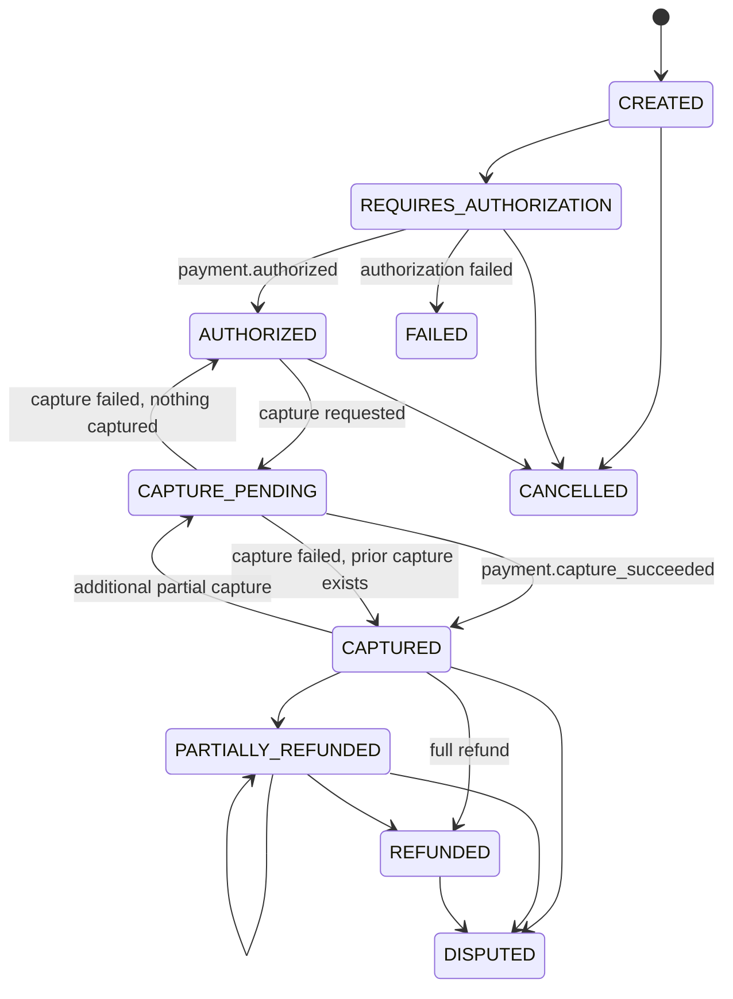
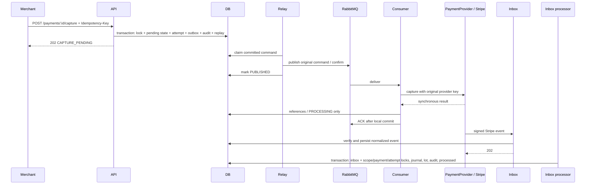

# Payment lifecycle

Status: current.

`POST /payments` creates intent in minor units. Manual capture waits for explicit authorization/capture commands. Automatic capture records an authorization request and, after the authorized webhook, creates a capture outbox event. Partial captures use the same capture operation while the remaining authorized amount is positive.

Authorization reserves customer funding capacity only. Capture creates a provider receivable and merchant pending liability. Settlement converts the provider receivable to cash and moves merchant pending to available. Payout consumes available funds. These are deliberately separate.

## Dormant MANUAL authorization application

[Migration0013](../apps/api/drizzle/0013_manual_authorization_application.sql) defines the private P-B SQL contract. A restricted caller prepares from an accepted AUTHORIZE command, its exact signed B1 proof, current inbox claim and expected evidence revisions, then applies the frozen SQL plan in the same READ COMMITTED transaction. It requires the original complete D02 COMMAND_RESULT and a MANUAL payment awaiting authorization. Success establishes the canonical root, tagged proof, successful attempt, AUTHORIZED payment, immutable provider audit, exact source dispositions, scope revision and PROCESSED inbox atomically.

The result is `VERIFIED_NO_EFFECT` with reason `AUTHORIZE_SUCCESS`: authorization recognizes no captured principal, fee, ledger journal or accounting lot. The original source obligations remain stored; only complete owned application evidence suppresses their exact causes for admission. A distinct source, reblocked receipt revision, delivery barrier or OPEN exception remains effective. Original-result recognition verifies historical evidence without repeating effects or requiring today's whole payment image to equal its authorization image.

Installation leaves contracts and enrollment empty and grants no runtime LOGIN capability. Private test composition installs only its DORMANT LEGACY/epoch0 contract. Production handlers remain unchanged. Automatic authorization, capture preparation/application/recovery and activation require separate checkpoints. The permanent [application](../apps/api/test/integration/manual-authorization-application.spec.ts) and [migration](../apps/api/test/integration/manual-authorization-migration.spec.ts) suites define the acceptance checks; execution results belong to the task checkpoint, not this contract description.

## Dormant protected first capture intent

[Migration0014](../apps/api/drizzle/0014_first_capture_intent.sql) adds the private P-C intent boundary. A caller supplies the completed P-B authorization root, a private request key, gross amount, fixture variant and expected payment/scope/intake revisions. SQL derives the owner, original authorization capacity, provider account/PaymentIntent, command identity and response. New work requires the exact P-B AUTHORIZED after-image, MANUAL capture, no prior capture/void or financial effects and no effective evidence blocker.

Each fresh authorization supports one first intent: FULL requests all authorized principal with `finalCapture=true`; FIRST_PARTIAL requests less with `finalCapture=false`; FINAL_PARTIAL requests less with `finalCapture=true`. This last variant is a private evidence fixture, not a new HTTP API option or verified Stripe multicapture entitlement. A second distinct request on the same payment is refused. All recognized monetary totals and the original AUTH record remain unchanged.

One READ COMMITTED transaction establishes CAPTURE_PENDING/version+1, the PENDING CAPTURE attempt, exact outbox, accepted D02 command, immutable audit, private replay response and guarded scope revision. The shared transaction/backend permit admits exclusively APPLICATION or CAPTURE_INTENT. Immediate exact-write guards and deferred complete-group validation reject missing or extra writes and prepare-only commits. Request replay verifies the immutable accepted intent and returns the original response without another command, permit or revision; later delivery bookkeeping does not redefine that response.

The [intent](../apps/api/test/integration/first-capture-intent.spec.ts) and [migration](../apps/api/test/integration/first-capture-intent-migration.spec.ts) suites exercise this contract using genuine P-B chains and restricted fixture principals. Scripted D02 execution and separately signed B1 sealing/binding occur only after intent commit. The signed capture receipt remains AWAITING_APPLICATION; its original D02 source retains BLOCKING_REVIEW/CAPTURE_AMOUNT_ATTRIBUTION_REQUIRED. Neither cause is discharged, and no capture journal/lot exists. B2-A still owns monetary preparation, B2-B capture accounting/finality, and B2-C capture acknowledgment/recovery. Installation grants no runtime LOGIN, installs no contract/enrollment and changes no production routing.

The sequence illustrates successful capture; webhook receipt can precede consumer reference persistence or ACK. Completion is driven by inbox processing, not by the synchronous response. Settlement/payout are internal accounting simulations. Partial capture is modeled by the application, but Stripe multicapture availability is account/payment-method dependent and not externally verified. Cancellation records local `CANCELLED` at request acceptance; see the [provider boundary limits](real-psp-stripe.md#translation-and-terminology-mismatches).

Confirmed new capture success also creates one `capture_accounting_lots` row in this same transaction, linked to the actual POSTED CAPTURE journal. Original gross/fee/net and exact financial posting time come from PostgreSQL journal evidence; eligibility freezes the merchant delay read for that posting as elapsed 24-hour days. A lot failure rolls back the journal, attempt/payment updates, mirror and audit. Duplicate successful attempts return without posting or backfilling old captures. These lots are dormant original evidence: refund/dispute/settlement services still use legacy accounting. See [B2.1 evidence and cutover limits](audits/h1-fix-02-b2-1-capture-integration.md).
